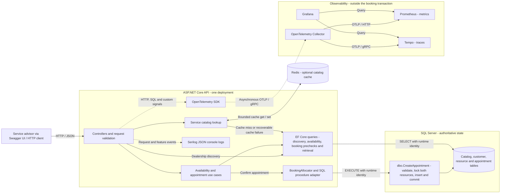
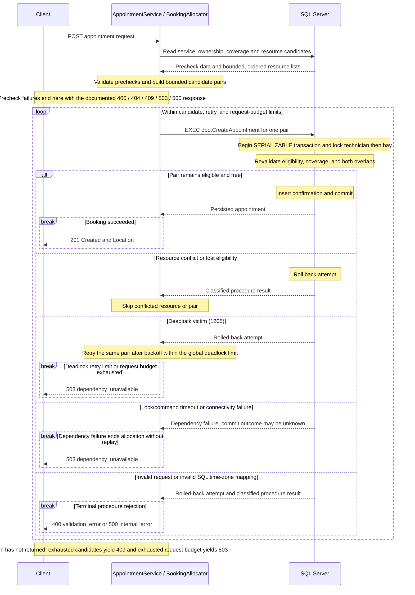

# Unified Service Scheduler - Architecture

This document owns the Unified Service Scheduler's domain model, assumptions, business rules, API contract, and component design. [README](../README.md) defines project scope and requirements; [[setup-guide]] owns local environment instructions.

## Scope and design approach

A service advisor requests an appointment for a customer and vehicle at a dealership. The API confirms the appointment only when a qualified technician and a service bay are available for its entire duration, then persists the booking and both resource associations atomically.

The implementation is a modular monolith: one deployable ASP.NET Core API, feature folders for scheduling use cases, and a small infrastructure boundary. Scheduling rules are separate from HTTP handling, database transactions, and provider-specific error mapping. Reads use EF Core directly; booking invokes a stored procedure through infrastructure.

This keeps deployment and debugging straightforward for a focused booking application. The database transaction provides a shared consistency boundary across API instances. Separate services and a message broker would add operational complexity without serving a current release requirement.

The initial release covers service discovery, availability, confirmation, and retrieval. OpenAPI and Swagger UI provide an interactive API client. Authentication, administrative CRUD, payments, notifications, cancellation, rescheduling, idempotency, and vehicle-overlap protection are outside the initial release. Dealership checks enforce data integrity; they are not authorization.

## Architecture diagram



The diagram shows runtime calls with solid arrows and diagnostic signals with dotted arrows. API components share one deployment; EF Core reads SQL directly, while appointment writes can only execute the booking procedure. SQL Server owns booking correctness. Redis stores only service-catalog copies, and cache hits avoid SQL. Serilog writes to console/container output; it is not exported through the Collector. The privileged one-shot setup process runs separately before API startup and owns migrations, runtime-principal provisioning, and seeding.

## Component roles and technology decisions

| Component              | Choice                                                            | Responsibility and reason                                                                                                         |
| ---------------------- | ----------------------------------------------------------------- | --------------------------------------------------------------------------------------------------------------------------------- |
| HTTP API               | .NET 10, ASP.NET Core controllers, DTOs, built-in DI, async I/O   | Validate requests, propagate cancellation, expose explicit response and Problem Details contracts                                 |
| Scheduling             | Feature-oriented C# use cases and pure rule functions             | Apply qualification, duration, ownership, opening-hour, and resource-selection rules independently of HTTP concerns               |
| Persistence            | EF Core 10 SQL Server provider and SQL Server 2022 Developer      | Model relationships with constraints, version schema through migrations, support indexed reads, and execute transactional booking |
| Booking write boundary | SQL Server stored procedure                                       | Revalidate and reserve both resources in one protected transaction across competing API instances                                 |
| Catalog cache          | Redis through IDistributedCache                                   | Reduce repeated service-catalog reads with bounded expiry and SQL fallback                                                        |
| Interactive API client | OpenAPI, Swagger UI                                               | Swagger UI provides an interactive interface to document, explore, and test APIs.                                                 |
| Logs                   | Serilog structured JSON console output                            | Capture request, booking, and dependency events with trace correlation                                                            |
| Telemetry pipeline     | OpenTelemetry SDK, OTLP exporter, Collector                       | Collect and export HTTP, SQL, runtime, and business signals through a common pipeline                                             |
| Metric storage         | Prometheus with OTLP receiver enabled                             | Store and query metrics exported by the Collector                                                                                 |
| Trace storage          | Grafana Tempo                                                     | Persist traces for investigation                                                                                                  |
| Dashboards             | Grafana with provisioned data sources and dashboards              | Reproduce operational views from committed configuration                                                                          |
| Automated tests        | xUnit, WebApplicationFactory, SQL Server and Redis Testcontainers | Verify pure rules, API contracts, persistence, locking, permissions, and cache behavior                                           |
| Local packaging        | Multi-stage Dockerfile and Docker Compose                         | Provide a repeatable API/dependency environment with explicit initialization and persistent SQL storage                           |

`global.json`, `Directory.Packages.props`, the Dockerfile, and Compose pin the SDK, NuGet packages, and container images used by the project.

## Application structure and initialization

The runtime flow is `controller -> feature use case -> EF Core query or infrastructure adapter`. Feature folders are `Dealerships`, `ServiceCatalog`, `Availability`, and `Appointments`. Pure scheduling helpers handle interval parsing, opening/shift coverage, overlap checks, and candidate planning; infrastructure owns provider-specific SQL, Redis, and telemetry behavior.

Startup has two separate modes:

1. **Setup:** an exact `--db-setup` argument selects the privileged initialization command before web-host construction. It applies migrations, validates time-zone mappings and the booking procedure, provisions the restricted runtime principal, and extends synthetic shifts.
2. **API:** validates runtime SQL, cache, booking, and telemetry options, then serves HTTP with the runtime identity. It does not run migrations or provision identities. Compose starts it only after setup succeeds; Redis and telemetry health do not gate API startup.

The setup connection and runtime password are initialization inputs. Normal API mode binds the runtime connection rather than the privileged setup connection. SQL Server is the authoritative state and transaction boundary; neither Redis nor telemetry participates in an appointment commit.

| Component | Path and behavior |
| --- | --- |
| Solution and projects | `ServiceScheduler.slnx`; API in `src/ServiceScheduler.Api/`; xUnit v3 projects in `tests/ServiceScheduler.UnitTests/` and `tests/ServiceScheduler.IntegrationTests/`. |
| Composition root | `src/ServiceScheduler.Api/Program.cs` registers controllers, Problem Details customization, built-in OpenAPI transformers, Swagger UI, options validation, the application `TimeProvider`, the DbContext, the bounded Redis cache, the SQL dependency exception handler, health checks, Serilog JSON logging, the telemetry options validator, and the telemetry provider hosted service. `UseRouting` precedes the request-logging middleware, which precedes the exception handler. An exact `--db-setup` argument branches to setup before web-host construction. |
| Toolchain | `global.json` pins SDK `10.0.403`; central package versions are in `Directory.Packages.props`; the local `dotnet-ef` tool is pinned in `.config/dotnet-tools.json`. |
| Configuration | API mode binds and validates `ConnectionStrings:Runtime`, `ConnectionStrings:Cache`, `Scheduler:Cache:*`, `Scheduler:Booking:*`, and `Scheduler:Telemetry:*`. Setup mode reads `ConnectionStrings:Setup` and `Scheduler:RuntimePassword` from environment variables and never binds the cache. `.env` is used by Compose interpolation, not auto-loaded by `dotnet run`. |
| Persistence model | `Infrastructure/Persistence/Entities/` and `Configurations/` map the shared-domain tables, including `TimeZoneMappings`, with UUID identifiers, UTC `datetimeoffset(7)` instants, local `time(0)` opening hours, composite consistency FKs, named checks/indexes, and `NO ACTION` delete behavior. |
| Migrations | `20261031092016_InitialCreate` creates the base schema and seeds; `20261101161530_AddBookingProcedureAndTimeZoneMappings` adds `dbo.TimeZoneMappings`, the dealership mapping FK, and `dbo.CreateAppointment`. |
| Setup mode | `Infrastructure/Setup/DatabaseSetupRunner.cs` applies migrations, validates the IANA-to-Windows mapping and booking procedure through `TimeZoneMappingValidator`, `RuntimePrincipalProvisioner` creates `scheduler_app` with the exact read/execute/deny grants, and `FutureShiftSeeder` adds weekday 09:00-17:00 shifts for the next 28 local calendar days. |
| Runtime identity boundary | The API uses `scheduler_app`; it has database `CONNECT`, schema `dbo` `SELECT`, object `EXECUTE` on `dbo.CreateAppointment`, and explicit object `DENY INSERT`/`UPDATE`/`DELETE` on `dbo.Appointments`. Direct appointment writes and DDL are denied; setup uses local `sa` only for isolated initialization. |
| Health endpoints | `/health/live` runs no checks and returns JSON. `/health/ready` runs `ready`-tagged SQL (`database`, 5-second timeout) and Redis (`redis`, 2-second registration timeout) checks with a JSON response writer that exposes only names/statuses/durations. Healthy and Degraded return `200`; SQL Unhealthy returns `503`. |
| OpenAPI and Swagger | `/openapi/v1.json` and `/swagger/index.html` are mapped in Development (including test hosts). The document includes the five API operations, DTOs, error statuses, ordering, explicit-offset input, booking `Location`/`409 capacity_unavailable`, and Problem Details `code`/`traceId` extensions. |
| Tests | Unit tests cover configuration/cache/error/scheduling rules plus booking options, candidate planning, allocator failure policy, telemetry options/enrichers/middleware, custom spans/counters, and cache telemetry. Integration tests use WebApplicationFactory, real SQL Server/Redis Testcontainers, independent runtime/setup connections, deterministic fixed clocks, per-class Redis databases, pinned Collector/Prometheus/Tempo/Grafana Testcontainers, and schema/migration/upgrade/permission/seed/health/catalog/availability/booking/concurrency/timeout/outage/telemetry-delivery/provisioning checks. |
| Containers | `src/ServiceScheduler.Api/Dockerfile` has `runtime` and `setup` targets and pins SDK `10.0.403`; `compose.yaml` runs SQL Server 2022 Developer, Redis `7.4.12-alpine`, one-shot setup, the API, Collector `0.164.0`, Prometheus `v3.15.1`, Tempo `3.1.1`, and Grafana `13.3.0` with named volumes and loopback ports. The API depends only on successful setup, not Redis or telemetry health. |
| API conventions | Feature-local controllers and contract records handle request/response mapping; scheduling/query rules stay outside HTTP; DTOs are feature-local; asynchronous I/O propagates cancellation tokens. |

## Discovery and availability

| Area | Behavior |
| --- | --- |
| Discovery | `GET /api/dealerships` reads seeded dealerships with `AsNoTracking`, ordered by name then ID, and returns `{ id, name, timeZoneId }`. |
| Catalog cache-aside | `GET /api/dealerships/{dealershipId}/service-types` uses the v1 dealership-scoped key, a 10-minute absolute TTL, a 250 ms per-operation budget, and a 500 ms configured read+populate budget. Hits avoid SQL; misses read SQL and populate; `404` and dependency failures are never cached. |
| Availability | `GET /api/dealerships/{dealershipId}/availability` captures the clock once, requires an explicit offset and a strictly future start, derives the end from the SQL duration, requires one local opening interval and one UTC shift to cover the full interval, and evaluates technician and bay conflicts independently with half-open predicates. No writes and no Redis reads occur. |
| Error contract | `code` and `traceId` are added consistently to Problem Details: `validation_error` (400), `not_found` (404), `dependency_unavailable` (503), and `internal_error` (500). Classified SQL connectivity/timeout/deadlock errors map to `503`; other failures remain sanitized `500`. |
| Health | Readiness reports SQL plus optional Redis state in JSON; Redis-only failure is `Degraded` with HTTP `200`; SQL failure is `Unhealthy` with `503`; liveness stays dependency-free. |
| Manual API checks | Swagger UI at `/swagger/index.html` supports checking availability, equivalent offsets, and `400`/`404` examples. |

## Booking and retrieval

| Area | Behavior |
| --- | --- |
| Confirmation | `POST /api/dealerships/{dealershipId}/appointments` validates the customer/vehicle ownership, dealership/service scope, explicit-offset start, SQL duration/end, one local opening interval, and one technician shift; selects bounded ordered candidates; and returns `201 Created` with a followable `Location` and the complete persisted response. A repeat POST is a new attempt. |
| Retrieval | `GET /api/dealerships/{dealershipId}/appointments/{appointmentId}` reads with `AsNoTracking` using both the appointment ID and dealership ID, returns stored start/end/duration/status/creation values, and returns `404` for missing or other-dealership appointments. It makes no Redis call. |
| Procedure | `dbo.CreateAppointment` is same-owner and static, rejects a caller-owned transaction, normalizes inputs to UTC, sets `XACT_ABORT ON`, `SERIALIZABLE`, and `LOCK_TIMEOUT 5000`, locks the technician row then the bay row with `UPDLOCK, HOLDLOCK`, revalidates ownership/scope/duration/active/qualified/opening/shift coverage, checks both half-open conflicts independently, inserts one `Confirmed` row with a duration snapshot, and commits. |
| Procedure errors | `51001` technician conflict; `51002` bay conflict; `51003` invalid request/ownership/scope/interval or caller-owned transaction; `51004` resource not eligible; `51005` opening/shift coverage unavailable; `51006` missing/invalid SQL time-zone mapping. |
| Allocation policy | Defaults are `MaxCandidateAttempts=5`, `MaxDeadlockRetries=2`, `RetryDelayMilliseconds=50`, `RequestBudgetSeconds=20`, and `CommandTimeoutSeconds=10`. Technicians are outer and bays inner in stable name/ID order. A technician conflict skips that technician; a bay conflict skips that bay; ineligibility/coverage skips only the pair. Exhausted pairs return `409 capacity_unavailable`, a deliberately non-exhaustive bound. |
| Failure handling | Only a SQL Server deadlock victim (`1205`) is retried, and only as a whole rolled-back attempt within the global bound. `1222`, `-2`, classified connectivity, and unknown commit outcomes return `503` without replay. `51003` maps to `400`; `51006` maps to sanitized `500`. Request cancellation propagates and is not converted into a dependency failure. |
| Time-zone mapping | `dbo.TimeZoneMappings` stores the IANA-to-Windows mapping (`Asia/Ho_Chi_Minh` -> `SE Asia Standard Time`; `Europe/London` -> `GMT Standard Time`). Setup validates the IANA and Windows identifiers and compares .NET/SQL local conversions for the Saigon and London DST fixtures. |
| Runtime boundary | `scheduler_app` has database `CONNECT`, schema `dbo` `SELECT`, object `EXECUTE` on `dbo.CreateAppointment`, and object `DENY INSERT`/`UPDATE`/`DELETE` on `dbo.Appointments`; there is no schema `EXECUTE`, direct write grant, DDL, ownership, or role. |
| Cache and telemetry | Booking reads `ServiceTypes.DurationMinutes` directly from SQL and never reads the catalog cache. Instrumentation observes booking decisions, retries, and the procedure boundary without controlling them. |

## Telemetry implementation

| Area | Behavior |
| --- | --- |
| Logging | Serilog compact JSON console output (no file/central sink), application/version/environment properties, `TraceId`/`SpanId`/`TraceFlags` from the current Activity, one sanitized `RequestCompleted` event per non-health request (route template, method, status code/class, bounded outcome, elapsed), and `EventName`/outcome fields on cache, booking, and dependency events. Framework scope properties carrying raw paths are removed; no request bodies, query strings, headers, VINs, or contact data are logged. |
| Correlation | Problem Details keeps `traceId`; when an Activity exists the value is the W3C 32-lowercase-hex trace ID, otherwise a non-empty request-identifier fallback. Logs and Tempo use the same trace ID. The OpenAPI description documents the semantics. |
| Tracing | Conditional OpenTelemetry SDK providers (none when disabled), OTLP/gRPC to the Collector, parent-based sampling (`1.0` in Compose), ASP.NET Core server spans, SqlClient spans for EF reads and the direct `dbo.CreateAppointment` command, and custom `availability.evaluate`, `booking.allocate`, and `cache.get`/`cache.set`/`cache.remove` activities. Server `url.path`/`url.query`/user-agent/server address/port and original method tags are removed; SQL parameter capture stays disabled. |
| Metrics | Custom `ServiceScheduler` meter: `scheduler.http.requests`, `scheduler.booking.outcomes`, `scheduler.booking.procedure.attempts`, `scheduler.cache.operations`, and `scheduler.booking.allocation.duration`, plus built-in `http.server.request.duration`; explicit buckets/Views restrict tag keys to bounded route/method/status/outcome/result vocabularies. Health requests are excluded from request logs/metrics/server spans, and the Collector drops health latency datapoints before Prometheus. |
| Stack | Collector `0.164.0` receives OTLP and fans out traces to Tempo and metrics to Prometheus's OTLP receiver; Prometheus retains 24 h/512 MB; Tempo retains 24 h locally; Grafana provisions data sources (`prometheus`, `tempo`) and the `scheduler-overview` dashboard. All ports bind to `127.0.0.1`; Grafana uses anonymous Viewer access. |
| Resilience | Exporters and Collector queues/timeouts are bounded; telemetry is not a readiness check. API startup, reads, booking, and readiness remain correct with telemetry backends stopped; new telemetry resumes after recovery without backfill. Redis/SQL outage behavior is unchanged and now emits degradation/dependency signals. |

## API boundary

| Operation            | Endpoint                                                                          | Behavior                                                                                                           |
| -------------------- | --------------------------------------------------------------------------------- | ------------------------------------------------------------------------------------------------------------------ |
| Dealership discovery | `GET /api/dealerships`                                                            | Return seeded dealerships and their time zones, ordered by name then ID |
| Catalog              | `GET /api/dealerships/{dealershipId}/service-types`                               | Retrieve dealership service types through the bounded optional cache |
| Availability         | `GET /api/dealerships/{dealershipId}/availability?serviceTypeId=...&startsAt=...` | Evaluate the requested service and start against authoritative SQL data; no reservation is created |
| Confirmation         | `POST /api/dealerships/{dealershipId}/appointments`                               | Allocate one technician and one bay through the booking procedure, persist the confirmed appointment, and return `201` with a retrieval Location; no pair returns `409 capacity_unavailable` |
| Retrieval            | `GET /api/dealerships/{dealershipId}/appointments/{appointmentId}`                | Return the persisted appointment using stored values; an appointment outside that dealership returns `404 not_found` |
| Liveness             | `GET /health/live`                                                                | Report process liveness independently of dependencies |
| Readiness            | `GET /health/ready`                                                               | Require SQL Server readiness and report optional cache degradation |

> [!NOTE]
> OpenAPI and Swagger UI are exposed in Development, including the Compose demo and test hosts. Health endpoints report dependency state; telemetry remains independent of readiness.

The POST accepts customer, vehicle, service type, and a start instant. The server calculates duration and end time and selects resources. Clients cannot select resource IDs, duration, or an end time.

POST body shape:

```json
{
  "customerId": "<seeded-customer-uuid>",
  "vehicleId": "<seeded-vehicle-uuid>",
  "serviceTypeId": "<seeded-service-type-uuid>",
  "startsAt": "<future ISO-8601 timestamp with Z or explicit offset>"
}
```

The bracketed strings illustrate fields; use the stable seeded UUIDs and a future timestamp within the seeded shift horizon when trying requests in Swagger UI.

Successful POST returns `201`, a `Location` pointing to the retrieval route, and the appointment ID, all associations, UTC start/end, duration snapshot, status, and creation time. A valid availability query with no pair returns `200` with `available: false`; a failed booking due to capacity returns `409 capacity_unavailable`.

Use consistent Problem Details responses containing a stable application error code and trace ID. Error codes are `validation_error` for `400`, `not_found` for `404`, `capacity_unavailable` for `409`, `dependency_unavailable` for classified `503`, and `internal_error` for sanitized `500`. Invalid input, past/offset-free starts, ownership mismatches, and interval overflow return `400`; missing or out-of-dealership resources return `404`; unavailable booking capacity under the bounded policy returns `409`; classified database outages, exhausted deadlock retries, lock timeouts, and command timeouts return `503`. Unexpected failures return `500` without exposing stack traces or secrets. A valid availability request with no eligible pair returns `200` with `available: false`.

## Data flow and concurrency

### Dealership and service discovery

1. The client requests dealerships; the API reads the seeded dealership data from SQL Server with `AsNoTracking`, ordered by name then ID, and returns `{ id, name, timeZoneId }`.
2. For a dealership's service catalog, the API checks `scheduler:v1:dealership:{dealershipId:D}:service-types` with a 250 ms caller budget.
3. A hit deserializes and returns the v1 payload without SQL. On a miss or recoverable cache failure, the API checks dealership existence, reads the ordered service types from SQL Server, attempts a bounded cache write (250 ms) with a 10-minute absolute TTL, and returns the catalog.
4. Unknown dealerships return `404 not_found` and are not cached; classified SQL failures return `503 dependency_unavailable` and are not cached. Corrupt cached JSON is logged, removed, and treated as a miss.

### Availability check

1. Capture `evaluatedAt` once from the injected `TimeProvider`; bind `startsAt` as a raw string and require a trailing `Z` or explicit offset; normalize to UTC and require a strictly future start.
2. Read the dealership-scoped service duration and IANA time zone from SQL Server; unknown or cross-dealership references return `404 not_found`; compute the end with checked addition and reject overflow as `400 validation_error`.
3. Convert the UTC interval to dealership-local wall clock, require the same local date, and require one configured opening row to cover the interval.
4. Query one active, qualified technician whose single UTC shift covers the interval with no confirmed half-open conflict, and one active bay with no confirmed half-open conflict, independently and in name/ID order.
5. Return `{ dealershipId, serviceTypeId, available, startsAt, endsAt, evaluatedAt }` with UTC `Z` timestamps. A valid request with no eligible pair returns `200 available:false`; the read is uncached, creates no reservation, and does not consult Redis. Classified SQL failure returns `503`, never false availability.

### Appointment confirmation

1. Validate the request, customer/vehicle relationship, dealership/service scope, explicit timestamp offset, and future start using an injected TimeProvider.
2. Read SQL Server to find active, qualified resources whose shifts and dealership opening hours cover the entire service interval. Select candidates in a stable order. Availability results remain advisory.
3. Invoke the booking procedure for a candidate technician/bay pair. The procedure owns one short SERIALIZABLE transaction, uses SET XACT_ABORT ON and rollback/error handling, and locks the existing technician row followed by the bay row using UPDLOCK and HOLDLOCK. Hold both locks until commit or rollback, including when no appointments exist.
4. Within the same transaction, revalidate relationships, resource eligibility, configured duration, full opening/shift coverage, and both resource conflicts. Detect overlap with `existing.StartUtc < requested.EndUtc AND existing.EndUtc > requested.StartUtc`.
5. If either resource conflicts, reject the attempt. Otherwise insert one confirmed appointment with both resources and a duration snapshot, then commit before returning success.
6. For resource-conflict errors, evaluate another candidate within a documented bounded attempt limit. Return `409` when capacity cannot be reserved. Roll back before each new attempt.
7. Retry a deadlock victim (`1205`) only as a bounded retry of the whole rolled-back attempt. Exhausted deadlock retries, lock timeouts, and classified database unavailability return `503`. Unexpected failures remain controlled server errors; they are not automatically capacity conflicts.

Procedure contract: `dbo.CreateAppointment` returns `51001` technician conflict, `51002` bay conflict, `51003` invalid request/ownership/scope/interval or caller-owned transaction, `51004` resource not eligible, `51005` opening/shift coverage unavailable, and `51006` missing/invalid SQL time-zone mapping. Candidate attempts default to 5, deadlock retries to 2 with 50 ms/100 ms backoff, the procedure lock timeout is 5 seconds, the command timeout is 10 seconds, and the total request budget is 20 seconds. `AvailabilityQueries` supplies bounded ordered candidates; `BookingCandidatePlanner`/`BookingAllocator` own the skip and retry policy; `AppointmentService` owns the precheck; and `SqlAppointmentBookingProcedure` owns the parameterized SQL boundary.



The 20-second allocation budget is checked between operations and before procedure calls; it does not forcibly cancel an already-running SQL command at that exact deadline. Individual commands retain their configured timeout and request cancellation. Capacity exhaustion is a business outcome (`409`); exhausting the time or deadlock-retry budget is a dependency outcome (`503`).

The runtime principal receives read access and permission to execute the same-owner static booking procedure, with no direct appointment INSERT, UPDATE, or DELETE, schema-altering privileges, or owner/admin role. A separate privileged identity runs migrations and synthetic seeds. Real SQL Server integration tests exercise the procedure boundary and denied direct writes.

All booking writers must follow the same technician-then-bay lock order. Do not use stale snapshots, NOLOCK, process-local locks, Redis locks, or a unique start-time key as the sole overlap defense. Connection failure during commit can leave the outcome unknown; do not blindly retry the write when idempotency is unavailable.

The locking approach favors correct allocation over maximum write concurrency: requests competing for the same resources may wait. Keep transactions short, use indexed conflict queries, and measure contention before changing the strategy.

### Appointment retrieval

1. The client follows the confirmation's `Location` or requests an appointment by dealership and appointment ID.
2. The API reads the persisted appointment from SQL Server with the dealership predicate applied.
3. Return all associations, UTC start/end, duration snapshot, status, and creation time. Missing or other-dealership appointments return `404`.

The SQL Server named volume preserves stored appointments across ordinary API/container restarts. Retrieval does not depend on Redis. The GET operation uses `AsNoTracking`, filters by both appointment and dealership IDs, projects the stored values with `.UtcDateTime`, and returns the same `AppointmentResponse` shape as POST.

## Domain model, assumptions, and rules

The primary actor is a **service advisor**, acting on behalf of a customer. A customer owns a vehicle and requests a dealership service at a particular time. Each service has a defined duration and requires a qualified technician. The scheduler chooses one eligible technician and one bay, then confirms their reservation together.

| Entity | Important data | Responsibility |
| --- | --- | --- |
| Dealership | ID, name, IANA time-zone ID, opening-hour intervals | Defines the scheduling location and local operating calendar. |
| Customer | ID, name, minimal synthetic contact data | Identifies the customer associated with the booking. |
| Vehicle | ID, normalized VIN, customer ID, make, model | Identifies the customer's vehicle. |
| ServiceType | ID, dealership ID, name, positive duration in minutes | Represents a service offered at that dealership. |
| Technician | ID, dealership ID, name, active flag | Supplies one technician unit of capacity. |
| TechnicianQualification | Technician ID, service type ID | Records which services a technician may perform. |
| TechnicianShift | Technician ID, start and end instants | Defines continuous working intervals. Split intervals model breaks. |
| ServiceBay | ID, dealership ID, name, active flag | Supplies one bay unit of capacity. All seeded bays support all offered services. |
| TimeZoneMapping | IANA ID primary key, Windows ID | Maps the canonical IANA dealership zone to the identifier accepted by SQL Server `AT TIME ZONE`; seeded and validated at setup. |
| Appointment | ID, dealership/customer/vehicle/service/technician/bay IDs, UTC start/end, duration snapshot, status, creation time | Persists the confirmed booking and reserved interval. |

Use UUID identifiers mapped to SQL Server `uniqueidentifier`, UTC instants mapped to `datetimeoffset(7)` with offset zero, foreign keys, and database checks for positive durations and `end > start`. Keep resource/dealership relationships consistent in both validation and persistence. Do not allow a vehicle belonging to a different customer to be booked under the supplied customer ID.

### Assumptions

| ID | Decision for the initial implementation |
| --- | --- |
| AS-01 | One appointment uses exactly one technician and one bay for one uninterrupted interval. |
| AS-02 | Service duration is fixed per dealership service type; copy it into the appointment at confirmation. Later catalog changes must not alter existing appointments. |
| AS-03 | The client supplies a start instant with `Z` or an explicit UTC offset. Normalize to UTC for storage; convert to dealership local time for opening-hour checks. Reject offset-free input. |
| AS-04 | Use half-open intervals `[start, end)`. A booking ending at 10:00 may be followed by one starting at 10:00. |
| AS-05 | Reject past starts using an injected `TimeProvider`. There is no minimum lead time beyond being in the future. |
| AS-06 | The complete appointment must fit within one dealership opening interval and one technician shift. Seed weekday daytime hours; holidays, overnight opening intervals, and shift editing are outside the initial scope. |
| AS-07 | The API chooses resources in a stable order. Availability results do not reserve capacity and do not guarantee subsequent booking success. |
| AS-08 | Catalogs, qualifications, and shifts are read-only seeded configuration in the initial API. Concurrent resource administration is outside scope. |
| AS-09 | Use synthetic data and a local demo without authentication. Validate dealership scope as data integrity; do not describe it as authorization. Authentication and customer access control are future work. |
| AS-10 | Vehicle overlap prevention is a possible extension. The initial hard capacity invariants concern bays and technicians. |
| AS-11 | A repeat POST is a new booking attempt. Idempotency is outside the initial scope; do not claim exactly-once request handling. |

### Business rules

| ID | Rule | Traces to |
| --- | --- | --- |
| BR-01 | Customer, vehicle, dealership, and service must exist; the vehicle must belong to the customer. | A-01, A-03 |
| BR-02 | The service, selected technician, and selected bay must belong to the requested dealership. | A-01, A-02 |
| BR-03 | Calculate the end from the configured positive duration. Clients cannot choose an end time, duration, or arbitrary resource IDs. | A-02 |
| BR-04 | The technician must be active and qualified for that service; the bay must be active. | A-02 |
| BR-05 | Opening hours and a technician shift must cover the entire interval, including its end boundary. | A-02 |
| BR-06 | No confirmed appointment may overlap another confirmed appointment for the same technician or the same bay. | A-02, P-01 |
| BR-07 | Confirming the appointment and reserving both resources is one atomic database operation. A failed booking leaves no appointment or partial reservation. | A-03, P-01 |
| BR-08 | An availability read is advisory. Booking must recheck authoritative database state inside the protected SQL Server booking transaction before returning success. | A-02, P-01 |
| BR-09 | Redis and telemetry outages must not change booking correctness. Database unavailability prevents successful confirmation. | P-01, P-02, P-03 |

[[database/overview|Database overview]] owns the relationship diagram; [[database/schema|Schema reference]] owns physical table and column details. Index confirmed appointments separately by dealership/technician/start and dealership/bay/start, including end, for bounded conflict queries.

## Catalog and availability reads

Redis caches only service catalogs. The key is `scheduler:v1:dealership:{dealershipId:D}:service-types` with a configurable absolute TTL of ten minutes and a web-default JSON payload of `{ id, name, durationMinutes }`. On a miss, the API reads SQL Server and populates Redis; empty catalogs are cached as `[]`, while unknown dealerships and dependency failures are not cached.

Each cache operation has a 250 ms caller budget, so a normal read plus population is configured at 500 ms, excluding SQL/HTTP time. A corrupt cached payload adds one bounded remove, making 750 ms the absolute maximum cumulative cache wait. Recoverable Redis connectivity/timeout failures fall back to SQL Server and log warning-level degradation; request cancellation propagates; unrelated programming errors are not swallowed. Seeded catalog changes require affected-key invalidation or a namespace version change; the TTL bounds eventual freshness when invalidation fails. A cache hit for a dealership later removed from SQL is a documented staleness limitation.

Availability remains uncached. Booking duration, qualifications, shifts, and final allocation always use authoritative SQL Server data inside the booking validation path. Customer and vehicle data are not cached. See [[database/cache|Cache documentation]] for the maintained inventory.

## Observability and failure behavior

| Signal or dependency     | Behavior                                                                                   |
| ------------------------ | ------------------------------------------------------------------------------------------------------ |
| Logs                     | Serilog compact JSON console output with application/version/environment and `TraceId`/`SpanId`/`TraceFlags`; one bounded `RequestCompleted` event per non-health request; cache/booking/dependency events are sanitized and carry `EventName`/outcome fields. ASP.NET Core scope properties such as `RequestPath`/`RequestId` are removed. |
| Traces                   | ASP.NET Core server spans, SqlClient spans for EF reads and `EXECUTE dbo.CreateAppointment`, and custom `availability.evaluate`, `booking.allocate`, and `cache.get`/`cache.set`/`cache.remove` activities. Server `url.path`/`url.query`/user-agent/server address/port are removed; SQL parameter values are not captured. |
| Metrics                  | `scheduler.http.requests`, `scheduler.booking.outcomes`, `scheduler.booking.procedure.attempts`, `scheduler.cache.operations`, `scheduler.booking.allocation.duration`, and built-in `http.server.request.duration` with bounded labels/buckets. Health request traffic is excluded from request logs/metrics and server spans; the Collector drops health latency datapoints before Prometheus. |
| Redis outage             | bounded SQL fallback within the configured budget; cache failure log/metric and cache activity; readiness `Degraded`/`200`; booking correctness remains independent of cache state. |
| SQL Server outage        | discovery, availability, and catalog misses return `503 dependency_unavailable`; a valid catalog cache hit may return `200`; readiness `503`; liveness `200`; no false availability or capacity result. |
| Telemetry backend outage | bounded asynchronous OTLP/Collector queues and timeouts; API startup, reads, booking, and readiness are unaffected; new telemetry resumes after recovery without backfill. |

Use bounded metric labels such as route templates, methods, status classes, and outcome codes. Keep raw URLs, appointment IDs, VINs, customer IDs, and trace IDs out of metric labels. Use synthetic data and avoid logging request bodies or customer contact details. Logs remain available through container output; Grafana is a visualization layer, not log or trace storage. A client-aborted request is completed as `client_cancelled` with status 499 and is not counted as a 5xx application error.

The OpenTelemetry SDK sends metrics and traces over OTLP/gRPC to the Collector, which forwards metrics to Prometheus with its OTLP receiver enabled and traces to Tempo. Grafana queries both backends through provisioned data sources (`prometheus`, `tempo`) and the committed `scheduler-overview` dashboard. Sampling is parent-based with Compose ratio `1.0`; lower ratios intentionally omit traces. Exporters use bounded queues, batch sizes, timeouts, and Collector memory/retry limits. Prometheus retains 24 h/512 MB and Tempo 24 h locally. Serilog writes JSON logs to console/container output with application version and trace/span IDs; centralized log storage is outside scope. Telemetry is disabled by default outside Compose/tests and is not a booking or readiness dependency. See [[setup-guide]] for access and troubleshooting.

## Deployment and scalability

Docker Compose runs SQL Server, Redis, a one-shot `db-setup` service, the API, Collector, Prometheus, Tempo, and Grafana with loopback ports and persistent data volumes. SQL Server uses the named volume `scheduler-sql-data`; the API starts only after setup exits successfully and does not depend on Redis or telemetry health. Run migrations and synthetic seeding through the privileged setup step before API readiness. Keep runtime credentials separate and supply local configuration outside committed secrets.

The API can serve requests from multiple instances while SQL Server serializes competing reservations. Availability queries must remain bounded and indexed. The single database remains a capacity and availability dependency; measure actual workloads before claiming throughput or availability guarantees.

Measure request latency and throughput under a stated dataset and workload, including cold/warm catalog reads. No performance targets or high-availability guarantees have been demonstrated. SQL Server Developer is scoped to local development and testing; production hosting, licensing, backup/recovery operations, and availability topology remain outside this local release plan.

Operational setup and recovery commands belong in [[setup-guide]].

## Design decisions and maintenance

| Decision | Reason |
| --- | --- |
| One API deployment with feature folders | Keeps scheduling use cases cohesive and local deployment straightforward. |
| SQL-owned booking transaction and resource locks | Protects both resource reservations across concurrent API instances. |
| Separate setup and runtime SQL identities | Allows schema initialization while restricting application writes to the booking procedure. |
| UTC instants plus dealership-local opening hours | Supports equivalent client offsets and local operating calendars. |
| Optional, bounded catalog cache | Reduces repeated reads while keeping scheduling decisions authoritative in SQL. |
| Bounded retries without replaying unknown commits | Handles rolled-back deadlocks without risking duplicate writes after connection failures. |
| Asynchronous telemetry with bounded labels and queues | Provides diagnostics without making telemetry a booking dependency. |

Update this document when components, data flow, transaction boundaries, assumptions, or operational behavior change. Keep physical schema details in [[database/schema]], configuration and commands in [[setup-guide]], and development history in the dedicated delivery records.

## Technical references

- [.NET support policy](https://dotnet.microsoft.com/en-us/platform/support/policy): supported LTS runtime choice.
- [SQL Server EF Core provider](https://learn.microsoft.com/en-us/ef/core/providers/sql-server/): `Microsoft.EntityFrameworkCore.SqlServer` and `UseSqlServer`; use package versions compatible with EF Core 10.
- [SQL Server table hints](https://learn.microsoft.com/en-us/sql/t-sql/queries/hints-transact-sql-table): `UPDLOCK` and `HOLDLOCK` for transactional resource locking in the booking procedure.
- [SQL Server object permissions](https://learn.microsoft.com/en-us/sql/t-sql/statements/grant-object-permissions-transact-sql): procedure execution and table permissions for the runtime principal.
- [SQL Server ownership chains](https://learn.microsoft.com/en-us/sql/relational-databases/tutorial-ownership-chains-and-context-switching): controlled data access through stored procedures.
- [EF Core connection resiliency](https://learn.microsoft.com/en-us/ef/core/miscellaneous/connection-resiliency): transaction retry boundaries and unknown commit outcomes.
- [SQL Server Linux containers](https://learn.microsoft.com/en-us/sql/linux/install-upgrade/quickstart-install-docker): container prerequisites and local setup.
- [EF Core concurrency](https://learn.microsoft.com/en-us/ef/core/saving/concurrency): concurrency tokens protect updates/deletes of tracked rows; overlapping new rows require separate protection.
- [OpenTelemetry .NET exporters](https://opentelemetry.io/docs/languages/dotnet/exporters/): OTLP export and Prometheus receiver configuration.
- [OpenTelemetry SqlClient instrumentation](https://github.com/open-telemetry/opentelemetry-dotnet-contrib/blob/main/src/OpenTelemetry.Instrumentation.SqlClient/README.md): SQL Server command traces through `Microsoft.Data.SqlClient`.
- [SQL Server Testcontainers for .NET](https://dotnet.testcontainers.org/modules/mssql/): `Testcontainers.MsSql` for real SQL Server integration tests; use the Redis module for cache tests.

References checked on 2026-10-27. SDK, NuGet, and container versions are pinned in `global.json`, `Directory.Packages.props`, the Dockerfile, and Compose; keep floating `latest` image tags out of the released application.
