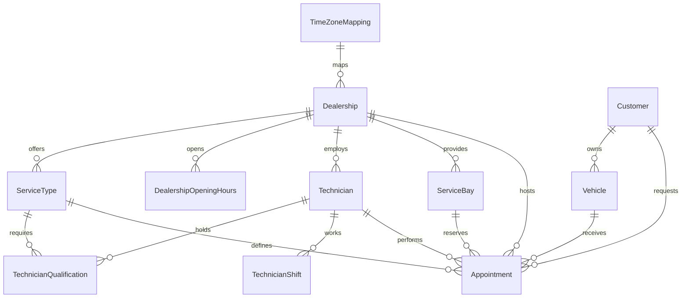

# Scheduler database overview

SQL Server 2022 with EF Core 10 stores the scheduling domain. Redis holds optional service-catalog copies, not booking reservations. `dbo.CreateAppointment` owns atomic confirmation, while `dbo.TimeZoneMappings` supports dealership-local opening-hour checks in SQL. Booking and retrieval do not depend on Redis. See [[architecture]] for scheduling rules and assumptions.

## Relationships

Every appointment references exactly one customer, vehicle, dealership, service type, technician, and bay. Qualifications model the many-to-many relationship between technicians and service types. `TimeZoneMappings` maps the dealership's canonical IANA identifier to the Windows identifier accepted by SQL Server `AT TIME ZONE`; a `Dealerships.TimeZoneId` FK requires a mapping. `dbo.DealershipOpeningHours` stores opening hours for local weekday intervals, with Sunday encoded as 0 and Saturday as 6, and `time(0)` opening/closing values. The migrations create every table in this diagram; the integration suite applies them to real SQL Server. See [[database/schema|Schema]] for the physical contract, including required columns, composite consistency FKs, and `NO ACTION` delete/update behavior.

## Integrity and booking rules

- Use UUID identifiers and foreign keys. Validate and persist consistent dealership relationships and customer/vehicle ownership.
- Store instants in UTC. Use the dealership's IANA time-zone ID when checking local opening hours. The entire appointment must fit within one opening interval and one technician shift.
- Use half-open intervals `[start, end)`. Adjacent appointments are allowed; overlapping confirmed appointments for either a technician or a bay are not.
- Copy service duration into the appointment at confirmation. Later catalog changes must not change existing appointment intervals.
- `dbo.CreateAppointment` uses one short `SERIALIZABLE` transaction with `SET XACT_ABORT ON`, locks the technician row then the bay row with `UPDLOCK, HOLDLOCK`, revalidates ownership/scope/duration/eligibility/opening/shift coverage, rechecks both half-open conflicts independently, then inserts one `Confirmed` appointment and commits.
- Restrict runtime appointment writes to that procedure. The setup identity uses local `sa`; the API and tests use `scheduler_app` with `CONNECT`, schema `SELECT`, object `EXECUTE` on `dbo.CreateAppointment`, and object `INSERT`/`UPDATE`/`DELETE` denies on `dbo.Appointments`. Future mutation paths must preserve the same booking protection.

The API uses read-only seeded catalogs, shifts, and qualifications. Discovery and availability query SQL relationships and indexes; Redis stores only an optional catalog copy. Telemetry is stored in Prometheus and Tempo rather than application tables. Authentication, cancellation, rescheduling, and vehicle-overlap protection are outside the current API scope.

See [[database/schema|Schema]] for column details, [[database/migration|Migrations]] for verification requirements, and [[database/maintenance|Maintenance guideline]] for documentation updates.
