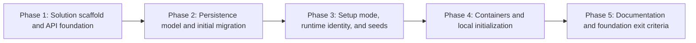

# 1 - Init Project: Implementation plan

- Ticket: [[1 - Init Project]]
- Research: [[research/1/00-overview|Foundation research overview]], with [[research/1/01-platform-foundation|platform]], [[research/1/02-persistence-and-identity|persistence and identity]], and [[research/1/03-testing-and-verification|testing and verification]] parts.
- Requirement IDs: ticket scope S1-S11, acceptance criteria AC-1-AC-9, verification cases T-14 and T-16, and the foundation portions of D-01-D-04 and P-04.
- Scope: deliver the executable, testable foundation only: toolchain and projects, API host conventions, configuration/startup validation, OpenAPI/Swagger, health checks, shared-domain schema and initial migration, separate setup/runtime database identities, synthetic seeds, Docker/Compose packaging, test foundation, and initial documentation.
- Plan structure: complex multi-phase plan under `docs/plans/1/` because ticket 1 has eleven scope items, nine acceptance criteria, and platform, persistence, container, and verification layers.
- Evidence baseline: research was inspected at revision `25be1577c895204e58bc74b4f80336486d33bb9c` (2026-10-30); this plan was prepared against checkout revision `ba36ac889e069b915e87a2b8f6ffbc59feeef1b1` (2026-10-31), which contained no application solution at plan-verification time. Implementation followed on 2026-10-31 in the same working tree. The staged `.mcp.json` change is unrelated to ticket 1.

> [!IMPORTANT]
> This plan was verified before implementation. The implementation now exists and was exercised locally on 2026-10-31; phase step statuses record implementation, while formal test evidence belongs in [[test/1-test|the ticket 1 test report]]. Do not treat a populated plan step as passing test evidence.

> [!NOTE]
> Research verification passed (2026-10-31) and plan verification passed (2026-10-31). All five implementation phases are implemented; the test phase records formal executed evidence in [[test/1-test|the test report]].

## Scope and assumptions

- The accepted gap resolutions G-01 through G-43 in [[research/1/00-overview#Accepted resolutions for G-03 through G-43 (2026-10-31)|the research overview]] are the planning contract; this plan does not reopen them.
- Implementation proceeds in dependency order. A phase may be selected with `/orchestrator-ticket implement 1 <phase>` once the plan has been verified.
- Automated tests accompany each implementation phase rather than being deferred to the end; the orchestrator test phase executes the complete matrix and records observed evidence in `docs/test/1-test.md`.
- Each phase updates the documentation it makes factual; Phase 5 consolidates README, architecture, setup guide, documentation index, and cross-document status.
- Planned paths use one API project with feature folders and a small persistence/infrastructure boundary, plus separate unit and integration test projects. No generic repository, mediator, or runtime AI dependency is introduced.
- All application identifiers, table names, constraint names, configuration names, and image pins below come from the accepted research contract; exact seed GUID values and migration IDs are assigned during implementation.
- Ticket 1 remains a local, unauthenticated, synthetic-data demo. Authentication, business endpoints, booking procedure, Redis, structured logging/telemetry stay out of scope.

## Planned repository layout

The following paths are proposed additions, not existing files:

```text
src/ServiceScheduler.Api/
  Program.cs
  Features/                         # reserved for tickets 2 and 3
  Infrastructure/
    Configuration/                  # DatabaseOptions and validation
    Persistence/
      Entities/                     # shared-domain entities
      Configurations/               # EF Core mappings, checks, indexes, static seeds
      SchedulerDbContext.cs
      SchedulerDbContextFactory.cs
    Setup/                          # --db-setup orchestration, principal SQL, shift seeder
  Migrations/                       # InitialCreate and model snapshot
tests/ServiceScheduler.UnitTests/
  Configuration/
tests/ServiceScheduler.IntegrationTests/
  Fixtures/
  Startup/
  Health/
  OpenApi/
  Persistence/
  Security/
```

Repository-root toolchain and packaging files are `global.json`, `Directory.Build.props`, `Directory.Packages.props`, `.editorconfig`, `.config/dotnet-tools.json`, `ServiceScheduler.slnx`, `src/ServiceScheduler.Api/Dockerfile`, `.dockerignore`, `compose.yaml`, and `.env.example`.

## Dependency graph



Phase 2 depends on the Phase 1 host and DbContext registration; Phase 3 depends on the Phase 2 migration and static seeds; Phase 4 depends on the Phase 3 `--db-setup` mode; Phase 5 depends on all implementation phases and the completed test matrix.

## Phase index

| Phase | File | Requirements | Depends on | Exit evidence |
| --- | --- | --- | --- | --- |
| 1 | [[plans/1/phase-1-api-foundation\|Solution scaffold and API foundation]] | S1-S4, S9, S10 test-foundation portion; AC-1, AC-2, AC-3, AC-6, AC-7; T-14 outage portion | None | Pinned toolchain; restore/build/format succeed; DTO/async/cancellation conventions documented; health, OpenAPI, Problem Details, and startup-validation tests execute; liveness `200` and readiness `503` against a non-listening SQL endpoint. |
| 2 | [[plans/1/phase-2-persistence\|Persistence model and initial migration]] | S5, S7 static-seed portion, S10 test-fixture portion; AC-4 migration portion; AC-5 constraint portion | Phase 1 | Initial migration applies to empty real SQL Server; schema checks/indexes/FKs match the schema contract; static seeds and invalid-insert tests execute. |
| 3 | [[plans/1/phase-3-identities-and-seeds\|Setup mode, runtime identity, and seeds]] | S6, S7; AC-4, AC-5; S10 fixture portion; T-14 ready portion | Phase 2 | `--db-setup` initializes an empty database idempotently; runtime reads succeed; direct appointment writes and DDL are denied; seeded future shifts cover the documented horizon. |
| 4 | [[plans/1/phase-4-containers\|Containers and local initialization]] | S3 container pins, S8; AC-8; T-16 Compose portion | Phase 3 | Compose configuration validates; pinned images build and run; setup gates API startup; named-volume restart preserves database and migration history. |
| 5 | [[plans/1/phase-5-verification-and-documentation\|Documentation and foundation exit criteria]] | S10 verification consolidation, S11; AC-1-AC-9; T-14, T-16 consolidation | Phases 1-4 | README, architecture, setup guide, database docs, documentation index, and deployment notes separate implemented from planned behavior; the test phase records the executed matrix. |

## Requirement traceability

| Requirement | Ticket intent | Plan coverage |
| --- | --- | --- |
| S1 | Controller/DTO/DI/async/cancellation/Problem Details scaffold | Phase 1 host composition, controller registration, Problem Details, documented DTO/async/cancellation conventions, and structural tests. |
| S2 | One API project plus separate unit/integration test projects; no forbidden abstractions | Phase 1 solution and project layout. |
| S3 | Pin SDK, EF Core 10 packages, and SQL Server 2022 container | Phase 1 toolchain pins; Phase 4 container pins. |
| S4 | Environment-based configuration, startup validation, `.env.example`, lint/format commands | Phase 1 options, validation, configuration files, and format check. |
| S5 | EF model, keys, checks, relationships, indexes, initial migration | Phase 2 entities, configurations, migration, and schema tests. |
| S6 | Separate privileged setup and restricted runtime identities | Phase 3 setup mode, principal provisioning, and permission tests. |
| S7 | Reproducible synthetic seeds with qualified technicians, active bays, and future shifts | Phase 2 static seeds; Phase 3 time-relative shift seeder. |
| S8 | API Dockerfile and SQL Server Compose service with named volume and explicit initialization | Phase 4 Dockerfile, Compose, and operational checks. |
| S9 | OpenAPI/Swagger UI and liveness/readiness endpoints | Phase 1 endpoints; Phase 3 initialized readiness; Phase 5 final checks. |
| S10 | xUnit, WebApplicationFactory, SQL Server Testcontainers, controllable time, fixtures, smoke checks | Phase 1 test projects and unit/API tests; Phase 2 SQL fixture; Phase 3 extended fixture and security tests; Phase 5 test-report handoff. |
| S11 | Initial system design and README build/run/test/setup instructions with evidence | Per-phase documentation updates; Phase 5 consolidation and test-report handoff. |
| AC-1 | Clean checkout restore, build, and run | Phase 1 scaffold; Phase 4 Compose; Phase 5 clean-checkout scenario. |
| AC-2 | Unit and integration test projects execute from the beginning | Phase 1 project creation and first tests; extended in Phases 2-3. |
| AC-3 | Missing/invalid configuration fails startup; format check runs | Phase 1 validator unit tests, startup integration tests, and format command. |
| AC-4 | Empty SQL Server initializes with migrations, runtime identity, and seeds | Phase 2 migration and static seeds; Phase 3 setup mode and idempotent seeds. |
| AC-5 | Constraints/relationships match model; runtime reads work; direct writes/schema changes denied | Phase 2 constraint tests; Phase 3 permission tests. |
| AC-6 | Liveness independent of database; readiness fails during outage | Phase 1 non-listening endpoint tests; Phase 3 initialized readiness; Phase 5 operational outage check. |
| AC-7 | OpenAPI/Swagger accessible; health/startup smoke tests pass | Phase 1 HTTP tests; Phase 3 ready `200`; Phase 5 operational checks. |
| AC-8 | Local Docker startup, named volume, and initialization documented and checked | Phase 4. |
| AC-9 | Architecture, README, and setup guide distinguish implemented from planned | Per-phase documentation updates; Phase 5 final review. |
| T-14 | Readiness outage/recovery behavior | Phase 1 outage portion (`live 200`, `ready 503`); Phase 3 ready `200`; Phase 5 operational stop/restart. |
| T-16 | Clean-checkout reproducibility and Compose persistence | Phase 4 Compose checks; Phase 5 clean-checkout run recorded by the test phase. |

## Verification

> [!NOTE]
> This section records the pre-implementation plan-verification gate and is retained as evidence. Implementation status is tracked in Overall progress and the formal executed results in [[test/1-test|the test report]].

- Command: `/orchestrator-ticket verify plan 1`.
- Status: **Passed**.
- Verified on: 2026-10-31.
- Research verification: `docs/research/1/00-overview.md` has `Status: Passed`; the ticket and research part fingerprints match the recorded verification for the current inputs, and the overview's current hash `7022c907ea79ee28c14a1e6bd72f09f412ab939d4e49bbc7946f31534077d789` matches its post-verification state.
- Input fingerprints (SHA-256): the plan overview fingerprint is for the plan content before this Verification section was recorded; this section is the plan verification record, not a plan step.
- Input table:

| Input | Fingerprint |
| --- | --- |
| `docs/tickets/1 - Init Project.md` | `2181f6ec689d20f6221deec961ccf71d085bd71e8f69d8d9adb5964eb4efcd33` |
| `docs/research/1/00-overview.md` | `7022c907ea79ee28c14a1e6bd72f09f412ab939d4e49bbc7946f31534077d789` |
| `docs/research/1/01-platform-foundation.md` | `5a91553bffd02af21df3aeaa84c75398770bca1dc96b03a83bf98193e07171f7` |
| `docs/research/1/02-persistence-and-identity.md` | `d5b871b8bb0a61ddca5f74ef44214b7be98529aeb43ea42946556b91e72d879f` |
| `docs/research/1/03-testing-and-verification.md` | `d455939df7d4e17f90c562a98fab1bcff695f5513a38da71b5350fb6de486fe6` |
| `docs/plans/1/README.md` | `bd277b6f0c2ebe44317c59c03a59fbf00305e21c3d0ef2746e86c4d30263a9e6` |
| `docs/plans/1/phase-1-api-foundation.md` | `09ddfa3c9245e7924e96f1862027a2925b938c3c31289e07cd9ae199b3e954e8` |
| `docs/plans/1/phase-2-persistence.md` | `7ad6b9cdb467bfdc6ab99df9830d70a3ac990bc6330ce03ef43a9ba2aa63cd42` |
| `docs/plans/1/phase-3-identities-and-seeds.md` | `9ed1cd1ff83c8ab40beeebba7199ad87cad51bbbcd1b45a2c965df9cc41b097c` |
| `docs/plans/1/phase-4-containers.md` | `17b3f09ffd0f61dff22e8574387e6b29f541a39ab1abaf66922f16928b326ac3` |
| `docs/plans/1/phase-5-verification-and-documentation.md` | `40c79ec96ab0c571006cd648181f06e52637384fa0b1390ba44436b228ed41fb` |
| `README.md` | `1ef7b147f9c958cde1c43210af702395d4bd854d9db8fd4b55e6d2973ca36270` |
| `docs/setup-guide.md` | `360635a58c54187f47ab43da8c96058d8d4feae256c8dc9eecd96efdc6c4c312` |

- Forward trace: every ticket scope item S1-S11, acceptance criterion AC-1-AC-9, and verification case T-14/T-16 maps to at least one phase and verification scenario; the phase index and requirement traceability table cover the full ticket.
- Reverse trace: every phase step and planned file traces to a ticket requirement or a necessary dependency; exclusions preserve the ticket scope boundaries; no booking procedure, Redis, telemetry implementation is planned.
- Phase/file check: `README.md` and phases 1-5 exist; each phase has requirements, dependencies, steps, completion criteria, and verification; no missing or ambiguous phase selector.
- Prerequisite order: Phase 1 -> Phase 2 -> Phase 3 -> Phase 4 -> Phase 5; Phase 2 depends on the Phase 1 host and model registration; Phase 3 depends on the Phase 2 migration and static seeds; Phase 4 depends on the Phase 3 `--db-setup` mode; Phase 5 depends on Phases 1-4 and the test matrix. No cycles.
- Call-path check: no application code exists, so there are no actual call chains to inspect; all paths and commands are labelled planned. The empty `SchedulerDbContext` in Phase 1 is a deliberate structural slice for the readiness check and is completed in Phase 2.
- Database/cache/deployment impact: Phase 2 schema, migration, and static seeds; Phase 3 runtime identity and future shifts; Phase 4 Compose, named volume, and deployment notes; no Redis cache key; no booking procedure or `EXECUTE` grant in ticket 1.
- Corrections applied during verification: added the S1 DTO/async/cancellation convention to Phase 1; added the S7 static-seed trace to Phase 2; aligned the Problem Details test path; updated the plan status, verification note, and progress table.
- Unresolved dependencies (non-blocking for plan verification): Docker SDK image execution and restore/build/publish; image pulls; SQL/Testcontainers execution; exact migration IDs and seed GUIDs; design-time factory and principal SQL parameterization; the executed test matrix. Each has phase exit evidence and remains Not run.
- Result: **Passed** for implementation planning. Implementation and executed verification remain pending.

## Cross-phase constraints

- Configuration names are fixed: `ConnectionStrings:Runtime` for API/test runtime use, `ConnectionStrings:Setup` and `Scheduler:RuntimePassword` for setup mode only, `MSSQL_SA_PASSWORD` and `MSSQL_PID` for the local SQL Server container.
- The runtime database user is `scheduler_app` with `CONNECT` and `GRANT SELECT ON SCHEMA::dbo` only; no write, execute, DDL, or broad role grants in ticket 1.
- The API never runs migrations or seeds at startup and never binds the setup connection; initialization is the explicit `--db-setup` mode.
- Startup validation checks configuration syntax and required keys only; it never opens a SQL connection, preserving liveness during database outages.
- Intervals and timestamps use UTC `datetimeoffset(7)` with offset zero; opening hours use local `time(0)` weekday intervals; `TimeProvider` is injected for current-time decisions and seeded shifts.
- All test evidence stays `Not run` until the test phase executes the scenario against the implemented revision; a build or generated test file is not passing evidence.
- Secrets remain in local environment/`.env` sources, `.env` stays ignored, and tests generate per-container passwords in memory without writing them to logs or reports.

## Database and cache impact

- Database impact: planned creation of `Dealerships`, `DealershipOpeningHours`, `Customers`, `Vehicles`, `ServiceTypes`, `Technicians`, `TechnicianQualifications`, `TechnicianShifts`, `ServiceBays`, and `Appointments` with the composite keys/FKs, checks, and indexes in [[database/schema|Schema reference]]; no booking procedure or `EXECUTE` grant in ticket 1.
- Migration impact: one planned `InitialCreate` migration under `src/ServiceScheduler.Api/Migrations`, recorded in [[database/migration|Migrations]] when generated.
- Cache impact: none in ticket 1; the seeded service-type shape is a future ticket-2 cache input. Record the no-impact reason in [[database/cache|Cache]].
- Deployment impact: per-ticket operational steps and recovery limits belong in `docs/deploy-notes/1-deploy-notes.md`, created in Phase 4.

## Prerequisites and risks

| Prerequisite or risk | Impact | Planned handling |
| --- | --- | --- |
| .NET SDK `10.0.401` available in Docker or on the host | Blocks restore/build only if neither execution environment provides the pin | Use the pinned Docker SDK image by default; verify `dotnet --version` there. Host installation is optional; do not change the pin silently. |
| Package versions restore together | Blocks build and test discovery | Use the G-01 baseline in central package management; adjust only with a recorded plan/research revision if restore exposes an incompatibility. |
| Docker engine with x86-64 Linux containers and at least 4 GiB allocated | Blocks Compose and Testcontainers operational checks | Record Blocked with the missing prerequisite per G-42; do not substitute mocked evidence. |
| Pinned SQL Server and .NET images pull successfully | Blocks containers and SQL integration tests | Use the G-14 `tag@sha256:digest` references; verify the SQL image tool path before finalizing the healthcheck. |
| Testcontainers SQL Server startup cost | Slows integration suites | One container per SQL collection, database per test class, parallelization disabled per G-12/G-32. |
| Windows/Linux IANA time-zone differences | Can break shift seeding | Seed `Asia/Ho_Chi_Minh` and `Europe/London`; resolve zones at setup and fail clearly if unsupported per G-16. |
| Kubernetes-style secrets or shared environments | Out of scope and unauthorized | Use only isolated local dependencies and synthetic data. |
| Implementation prerequisites: Docker SDK image execution, restore/build, image pulls, and SQL/Testcontainers execution | Blocks implementation evidence, not plan verification | Execute the planned checks and record Passed/Failed/Blocked results in the test report; do not claim unexecuted checks. |

## Overall progress

| Phase | Plan | Implementation | Verification |
| --- | --- | --- | --- |
| 1 | Verified | Implemented | Executed during implementation; test report executed (21/21 Passed) |
| 2 | Verified | Implemented | Executed during implementation; test report executed (21/21 Passed) |
| 3 | Verified | Implemented | Executed during implementation; test report executed (21/21 Passed) |
| 4 | Verified | Implemented | Executed during implementation; test report executed (21/21 Passed) |
| 5 | Verified | Documentation and handoff completed | Executed 2026-10-31: 21/21 cases Passed (TC-21 recovery delay up to about 10 s) |

Implementation is complete for all five phases. The test phase executed the matrix on 2026-10-31: 17 unit and 29 integration tests passed, and all 21 verification cases passed. TC-21 readiness recovered without an API restart but took up to about 10 seconds after a SQL Server restart in one controlled cycle. See [[test/1-test|the ticket 1 test report]]; implementation-phase command observations are recorded in [[deploy-notes/1-deploy-notes|the deployment notes]].
