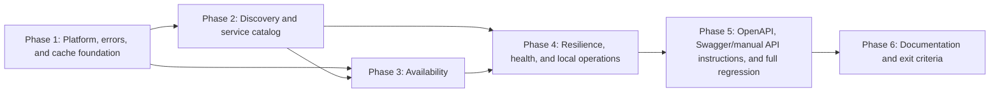

# 2 - Service Discovery and Availability: Implementation plan

- Ticket: [[2 - Service Discovery and Availability|Ticket 2]]
- Research: [[research/2/00-overview|Ticket 2 research overview]], with [[research/2/01-api-contracts-and-validation|API contracts and validation]], [[research/2/02-availability-and-scheduling|availability and scheduling]], [[research/2/03-catalog-cache-and-resilience|catalog cache and resilience]], and [[research/2/04-verification-and-documentation|verification and documentation]].
- Requirement IDs: S2-01 through S2-06, AC2-01 through AC2-07, T-02, T-03, T-04, T-10, T-11, T-12, T-13; project requirements A-02, D-01-D-04, P-02, and P-04.
- Scope: deliver the three read-only discovery/catalog/availability operations, explicit-offset and future-start validation, SQL-authoritative availability rules, the bounded Redis service-catalog cache-aside path, shared Problem Details error contracts, real SQL Server and Redis verification, Swagger/manual API instructions, and updated delivery documentation.
- Plan structure: complex multi-phase plan under `docs/plans/2/` because ticket 2 has six requirements, seven acceptance criteria, four research parts, and API, scheduling, persistence-read, cache, configuration, operations, test, and documentation layers.

> [!IMPORTANT]
> The plan-time callout recorded that this plan was not yet verified and ticket 2 was not implemented. The plan was verified on 2026-11-01, implemented in all six phases, and re-verified on 2026-11-01 after the ticket scope amendment; see Implementation status and Verification. The body below remains the approved plan record, and executed results belong to [[test/2-test|the test report]].

## Scope and assumptions

- The accepted decisions in [[research/2/00-overview#Phase 5: Consolidated gap register|the research gap register]] (G-01-G-22) are the planning contract; this plan does not reopen them.
- Ticket 2 owns only the A-02 read path and P-02 cache. Booking confirmation, appointment retrieval, the booking procedure, and concurrency remain ticket 3; Serilog/OpenTelemetry telemetry remains ticket 4; authentication and admin operations remain out of scope.
- Availability is advisory and performs no writes and no cache reads. The runtime identity remains `scheduler_app` with `SELECT` only; tests seed probe data through the privileged setup identity.
- No schema migration is planned. Existing opening-hours, technician, qualification, shift, bay, and appointment indexes cover the query predicates inspected during research; implementation must capture the EF-generated SQL and confirm the index mapping. A migration is added only if a concrete missing index is proven, and then follows [[database/migration|the migration guide]] and updates this plan and the deploy notes.
- Shared contracts are fixed by research: cache key `scheduler:v1:dealership:{dealershipId:D}:service-types`; 250 ms per cache operation with a 500 ms configured read+populate budget; absolute catalog TTL of 10 minutes; `code`/`traceId` Problem Details; wall-clock local opening evaluation; fixed test clock `2026-11-02T00:00:00Z`.
- Tests are written and executed inside their owning phase, not deferred to a final phase. The orchestrator `test` phase only generates the manual checklist; it does not supply automated evidence.
- `docs/test/2-test.md` is created in Phase 1 and extended with actual commands and observed results as each phase completes. [[test/1-test|The ticket 1 report]] remains the baseline for foundation checks and is not rewritten.
- Only isolated local SQL Server, Redis, and synthetic data are used. The configured `sqlserver` MCP server is unavailable in this session and is not required by the plan.
- `docs/README.md` was intentionally left unchanged by the planning phase so the plan-time research-verification fingerprints stayed valid. Phase 6 updated the documentation index after implementation; this re-verification uses the updated research inputs recorded in the Verification section.

## Evidence baseline

- Research verification: **Passed** for planning on 2026-11-01 (recorded in [[research/2/00-overview#Verification|the research overview Verification section]]).
- Freshness check at plan creation: the plan-time inputs matched the research-verification table; that record is historical. The 2026-11-01 scope amendment changed S2-06/AC2-01/AC2-07, the research was re-verified on 2026-11-01, and this plan was re-verified afterward; current fingerprints are in the Verification section.
- Checkout at plan creation: HEAD `3f8ab1e2cac26e54c5364f683d5df70cb1cfe5ff` (2026-11-01); the working tree contained the staged ticket 2 research and `docs/README.md` changes. Current checkout and re-verification inputs are recorded in the Verification section.
- Toolchain observed during research: .NET SDK `10.0.403` (host also has `8.0.100`), Docker `25.0.3`, Compose `v2.24.6-desktop.1`. Implementation must re-verify actual versions and record them in the test report.
- Input fingerprints (SHA-256) at plan creation:

| Input | Fingerprint |
| --- | --- |
| `docs/tickets/2 - Service Discovery and Availability.md` | `d62d11acb0958b653011ebdd442d00eabc105f05dc230eb35317d94013217413` |
| `docs/research/2/00-overview.md` | `c319496fd4401e74d0dddd9a87b668389c430ae09e46ffefc4b5fd699bff2655` |
| `docs/research/2/01-api-contracts-and-validation.md` | `df49a588f3969dd13a85ba6be1e944da8dfadd8b7f0bf56d37993238acb53be9` |
| `docs/research/2/02-availability-and-scheduling.md` | `f41d2819664a76334fc271caea46a471d0c3b8b2a265bf56464ecca884a9fa07` |
| `docs/research/2/03-catalog-cache-and-resilience.md` | `8dbc44891d6321130cc2da4d38b7c5bcb3e8b645f52274088287ae0ecc989f0d` |
| `docs/research/2/04-verification-and-documentation.md` | `ae285b47f93d5290de665c4fa754534def9322a4bc8756cfd199163ee5979169` |
| `docs/README.md` | `d0624847461ac55939e6142db7973700f9b14e29f490c290955c05530fa0e6bf` |

## Planned repository layout

Existing paths were inspected; paths marked **new** are proposed additions. No second host, repository/unit-of-work abstraction, or background job is introduced.

```text
src/ServiceScheduler.Api/
  Program.cs                                      # modify: DI, middleware, health, OpenAPI, error customization
  appsettings.json                                # modify: non-secret cache defaults
  Features/                                       # new
    Dealerships/
      DealershipsController.cs
      Contracts/DealershipResponse.cs
    ServiceCatalog/
      ServiceCatalogController.cs
      Contracts/ServiceTypeResponse.cs
      ServiceCatalogService.cs
      ServiceCatalogCacheKeys.cs
    Availability/
      AvailabilityController.cs
      Contracts/AvailabilityResponse.cs
      AvailabilityService.cs
      StartsAtParser.cs
      AvailabilityInterval.cs
      OpeningCoverage.cs
      ShiftCoverage.cs
      HalfOpenOverlap.cs
  Infrastructure/
    Caching/                                      # new
      CacheOptions.cs
      CacheOptionsValidator.cs
      RedisCacheConfiguration.cs
      BoundedCache.cs
      CacheHealthCheck.cs
    Errors/                                       # new
      ProblemCodes.cs
      SqlFailureClassifier.cs
      SqlDependencyExceptionHandler.cs
      ProblemDetailsConfiguration.cs
    Health/                                       # new
      HealthResponseWriter.cs
tests/ServiceScheduler.UnitTests/
  Availability/                                   # new: StartsAtParser, interval, opening, shift, overlap, composition
  Caching/                                        # new: bounded cache and catalog cache behavior
  Errors/                                         # new: SQL classifier and problem codes
  Configuration/CacheOptionsValidatorTests.cs     # new
tests/ServiceScheduler.IntegrationTests/
  Fixtures/RedisContainerFixture.cs               # new
  Fixtures/SqlServerAndRedisCollection.cs         # new
  Fixtures/CacheSqlServerTestBase.cs              # new
  Fixtures/SchedulingTestData.cs                  # new
  Fixtures/CacheKeys.cs                           # new
  Catalog/                                        # new
  Availability/                                   # new
  Resilience/                                     # new
  Health/CacheHealthTests.cs                      # new
  Startup/CacheConfigurationTests.cs              # new
  Startup/ProblemDetailsTests.cs                  # modify
  OpenApi/OpenApiTests.cs                         # modify
compose.yaml                                      # modify: Redis service
.env.example                                      # modify: cache connection/config
docs/test/2-test.md                               # new during Phase 1; extended per phase
docs/deploy-notes/2-deploy-notes.md               # started in Phase 4; finalized in Phase 6
docs/architecture.md, docs/setup-guide.md, README.md, docs/database/*.md, docs/README.md  # modify in Phase 6
```

## Dependency graph



Phase 4 exercises the catalog and availability paths from Phases 2 and 3; it cannot complete earlier. Phase 5 documents and exercises the complete surface, and Phase 6 records final behavior after all checks pass.

## Phase index

| Phase | File | Requirements | Depends on | Exit evidence |
| --- | --- | --- | --- | --- |
| 1 | [[plans/2/phase-1-platform-and-cache-foundation\|Platform, errors, and cache foundation]] | S2-04, S2-05; AC2-05, AC2-06 platform portions; project P-02 | None | Package pins restore/build; cache options validate; bounded cache and SQL classifier unit tests pass; `TimeProvider` and Problem Details customization registered; host starts and liveness returns `200` with an unreachable Redis; cache configuration failure is a clear startup error. |
| 2 | [[plans/2/phase-2-discovery-and-catalog\|Discovery and service catalog]] | S2-01, S2-05; AC2-01 partial, AC2-04; T-11 catalog portion, T-12; project D-02 | Phase 1 | Discovery and catalog endpoints return documented DTOs/order; real Redis miss/hit/expiry/invalidation/empty/unknown tests pass; cache hits avoid SQL; crash-safe degradation for corrupt payloads; test fixtures added. |
| 3 | [[plans/2/phase-3-availability\|Availability]] | S2-02, S2-03, S2-04; AC2-02, AC2-03; T-02, T-03, T-04, T-10, T-11; project A-02 | Phases 1 and 2 | Parser/rule unit tests pass; real SQL Server availability, eligibility, coverage, conflict, scope, DST, duration, read-only, generated-SQL, and sanitized-`500` tests pass; error contract assertions pass. |
| 4 | [[plans/2/phase-4-resilience-and-operations\|Resilience, health, and local operations]] | S2-05, S2-04; AC2-05, AC2-06; T-13; project P-02 | Phases 2 and 3 | Redis outage/stall and SQL outage tests pass within the configured budget; readiness body shows `Degraded`/`Unhealthy` correctly; Compose Redis service validates and starts without gating the API; stop/start and invalidation checks are recorded. |
| 5 | [[plans/2/phase-5-examples-and-regression\|OpenAPI, Swagger/manual API instructions, and full regression]] | S2-06; AC2-01; project P-04 | Phases 2-4 | OpenAPI document contains three operations, DTOs, statuses, ordering, and error extensions; Swagger/manual instructions match the implemented API; TC2-35 is retired; full unit/integration suites and `dotnet format --verify-no-changes` pass. |
| 6 | [[plans/2/phase-6-documentation-and-exit\|Documentation and exit criteria]] | S2-06; AC2-07; project D-01-D-04, P-04 | Phases 1-5 | README, architecture, setup guide, database/cache/schema/migration records, documentation index, deploy notes, and test report reflect implemented behavior with actual commands and results; unexecuted checks remain explicit. |

## Requirement traceability

| Requirement | Ticket intent | Plan coverage |
| --- | --- | --- |
| S2-01 | Dealership discovery and dealership-scoped catalogs | Phase 2 controllers/DTOs/ordered reads; Phase 5 OpenAPI/example coverage; Phase 6 records. |
| S2-02 | Explicit-offset/future-start validation, authoritative duration, local opening hours | Phase 3 parser, interval, opening coverage, SQL duration, UTC `Z` DTOs, DST policy tests. |
| S2-03 | Full-interval qualification, active resources, shift, independent conflicts via scoped SQL | Phase 3 technician/bay eligibility queries, half-open predicates, stable order, generated-SQL capture, scope/conflict tests. |
| S2-04 | Advisory response, consistent Problem Details, controlled SQL failure | Phase 1 error codes/classifier/handler; Phases 2-3 `400`/`404`/`503`/`500` mapping; Phase 3 sanitized failure test. |
| S2-05 | Redis cache-aside, TTL, invalidation, bounded fallback, health degradation | Phase 1 cache foundation/health; Phase 2 cache-aside lifecycle; Phase 4 outage/stall/configuration/Compose behavior. |
| S2-06 | Swagger/manual API instructions, automated verification, updated records | Phases 2-4 tests; Phase 5 OpenAPI/document tests and Swagger documentation; Phase 6 documentation and test report. |
| AC2-01 | Three endpoints/DTOs in OpenAPI and Swagger/manual API instructions | Phases 2-3 endpoints; Phase 5 operations/schemas/Swagger; Phase 6 README/setup records. |
| AC2-02 | Qualification, inactive resource, scope, coverage, boundary, time-offset, future-start, DST tests | Phase 3 unit/integration tests; Phase 1/2 supporting fixtures. |
| AC2-03 | Existing appointments, documented fields for both outcomes, SQL duration over stale cache, no mutation | Phase 3 availability/conflict/stale-duration/read-only tests. |
| AC2-04 | Miss/hit/expiry/invalidation against real Redis and SQL; hits avoid SQL | Phase 2 catalog cache tests. |
| AC2-05 | Redis outage/stall bounded fallback; availability correct; startup and readiness behavior | Phase 1 startup/cache foundation; Phase 4 resilience/health tests and operational checks. |
| AC2-06 | SQL unavailability is a controlled failure; catalog hit may be `200`; readiness `503` | Phase 2 hit behavior; Phase 3 error mapping; Phase 4 SQL outage/combined outage tests. |
| AC2-07 | README, Swagger/manual API instructions, cache/schema docs, and recorded results reflect implementation | Phase 5 OpenAPI/Swagger evidence; Phase 6 documentation and test report consolidation. |
| T-02 | Qualification/inactive resource | Phase 3 TC2-15-TC2-17. |
| T-03 | Partial shift/opening coverage | Phase 3 TC2-18. |
| T-04 | Interval boundaries and independent conflicts | Phase 3 TC2-19-TC2-21. |
| T-10 | Time handling and DST | Phase 3 TC2-12-TC2-14, TC2-23. |
| T-11 | Dealership scope | Phase 2 TC2-04, TC2-08; Phase 3 TC2-24. |
| T-12 | Cache lifecycle | Phase 2 TC2-02, TC2-05-TC2-08. |
| T-13 | Redis unavailable | Phase 4 TC2-09, TC2-10, TC2-30-TC2-32. |
| A-02 | Availability read rules | Phase 3 algorithm and tests; Phase 4 outage behavior. |
| D-01-D-04 | Architecture, API contract, setup, database/cache documentation | Phase 6 documentation updates, supported by Phase 4 operational evidence. |
| P-02 | Redis cache contract and resilience | Phases 1, 2, and 4. |
| P-04 | Verification and documentation discipline | Phases 1-6 test report and Phase 6 exit review. |

## Test ID assignment

| Test ID | Phase | Primary evidence |
| --- | --- | --- |
| TC2-01-TC2-08 | Phase 2 | Discovery/catalog contracts and cache lifecycle against real SQL Server and Redis. |
| TC2-09, TC2-10 | Phase 4 | Redis connection failure and stall with bounded SQL fallback. |
| TC2-11 | Phase 1 | Unit tests for bounded cache behavior, corrupt payload, cancellation, and unexpected exceptions. |
| TC2-12-TC2-25, TC2-29, TC2-34 | Phase 3 | Availability time/validation, eligibility, coverage, conflicts, read-only, duration, DST, scope, generated SQL, sanitized `500`, shared Problem Details error paths. |
| TC2-26-TC2-28, TC2-30, TC2-31 | Phase 4 | SQL outage, combined outage/recovery, readiness body/liveness, startup with unreachable Redis; TC2-32 is completed in Phase 1 and regressed here. |
| TC2-33; TC2-35 retired | Phase 5 | OpenAPI document assertions and full regression; standalone script case retired by scope amendment. |

## Cross-phase constraints

- Configuration names are fixed: `ConnectionStrings:Runtime` for SQL reads, `ConnectionStrings:Cache` for Redis, `Scheduler:Cache:ServiceCatalog:AbsoluteTtl`, `Scheduler:Cache:OperationTimeout`, `Scheduler:Cache:ConnectTimeout`, `Scheduler:Cache:CommandTimeout`, and `Scheduler:Cache:ConnectRetry`; setup mode never binds the cache connection.
- Cache key/payload are fixed at version `v1`: lowercase hyphenated GUID in the key and a JSON array of `{ id, name, durationMinutes }` with web-default camelCase, ordered by name then ID.
- Error codes are fixed: `validation_error`, `not_found`, `dependency_unavailable`, `internal_error`; `traceId` is present on validation, not-found, dependency, and unexpected failures, including framework-generated validation responses.
- `SqlFailureClassifier` maps only the narrow connectivity/timeout/deadlock list from research to `503`; authentication, permission, and programming failures remain `500`.
- Availability never reads or writes Redis, performs no appointment writes, and never returns `available:false` for a dependency failure.
- The application `TimeProvider` is registered once and replaced with `FakeTimeProvider(2026-11-02T00:00:00Z)` in availability tests; SQL duration and instants remain authoritative.
- Test MySQL/SQL/Redis isolation follows research: one SQL container per SQL collection, one Redis container per combined collection, one database per test class, a distinct Redis database index per class, and explicit cleanup.
- `dotnet build`, test, and format commands are labeled planned until the implemented files make them executable; every phase records actual command output in `docs/test/2-test.md`.
- No public booking write path, runtime write grant, test-only controller, CI workflow, or performance guarantee is added.

## Database, cache, and deployment impact

- Database impact: **none planned**. Ticket 2 reads existing tables and indexes; implementation captures generated SQL and documents the index mapping. If a concrete missing index is proven, add a migration in the owning phase, update [[database/schema|Schema reference]], [[database/migration|Migrations]], and the deploy notes, and record it as a plan deviation.
- Cache impact: **yes**. Phase 2 implements the catalog key/payload/TTL and Phase 6 records the inventory in [[database/cache|Cache]]: source `ServiceTypes` scoped by dealership, absolute 10-minute TTL, explicit `DEL`/version bump after seed changes, bounded fallback, cache-health degradation, and the documented limitation for a cache hit after a dealership is removed.
- Runtime permissions: unchanged; `scheduler_app` keeps `SELECT` only. Test probes use the privileged setup connection and remove only their own rows.
- Deployment impact: Redis service/configuration, cache invalidation, readiness/smoke checks, and rollback belong in `docs/deploy-notes/2-deploy-notes.md`; no schema backfill or downtime is planned.

## Rollback or forward recovery

| Area | Recovery action | Limits |
| --- | --- | --- |
| Application | Redeploy the previous API version; remove `ConnectionStrings:Cache` from a version that did not require it. | Discovery/availability revert to their previous behavior; no SQL data change. |
| Cache | Stop/remove Redis; delete the `scheduler:v1:dealership:*` keys or bump the key version. | Keys are ephemeral and contain no customer/vehicle data; stale keys expire within the TTL. |
| Database | No ticket 2 schema rollback planned. | If an unplanned migration is added, follow [[database/migration|the migration guide]]; a revert does not restore deleted data. |
| Configuration | Restore previous SQL settings; keep API startup independent of Redis health. | Readiness returns `200` for SQL healthy/Redis down and `503` for SQL down. |

## Verification

- Command: `/orchestrator-ticket verify plan 2` (re-verification after the 2026-11-01 research re-verification and ticket scope amendment).
- Status: **Passed**.
- Verified on: 2026-11-01.
- Research verification: **Passed** on 2026-11-01 against the amended ticket; see [[research/2/00-overview#Verification|the research Verification section]]. The current research fingerprints below match that record.
- Checkout: HEAD `3f8ab1e2cac26e54c5364f683d5df70cb1cfe5ff`; the working tree contains the ticket 2 implementation, research, plan, review, test, and deployment records, including the 2026-11-01 scope amendment that retired the standalone demo script.
- Previous verification: the 2026-11-01 pre-amendment plan verification was invalidated by the ticket amendment and the research re-verification; this section supersedes it. The plan body remains the approved plan record; executed results belong to [[test/2-test|the test report]].
- Input fingerprints (SHA-256 of LF-normalized content; CRLF checkout line endings are not part of the fingerprint): the plan overview fingerprint is for the plan content before this Verification section; this section is the plan-verification record, not a plan step.
- Input table:

| Input | Fingerprint |
| --- | --- |
| `docs/tickets/2 - Service Discovery and Availability.md` | `b0bed502b6a8b7e59fe4904b5924e80592d4de0248dd2c0f0476abb80feb64a5` |
| `docs/research/2/00-overview.md` (pre-Verification content) | `39f51052e5ea6e4ca95853c4ebb0c1da063a7ac189dd7bfc8cb4d2bf7e7d09f8` |
| `docs/research/2/01-api-contracts-and-validation.md` | `4bfc6d0fc1eb18d504203c553561c9e9c5184dcfb386ccf08e8a3fbe935e81db` |
| `docs/research/2/02-availability-and-scheduling.md` | `f41d2819664a76334fc271caea46a471d0c3b8b2a265bf56464ecca884a9fa07` |
| `docs/research/2/03-catalog-cache-and-resilience.md` | `8dbc44891d6321130cc2da4d38b7c5bcb3e8b645f52274088287ae0ecc989f0d` |
| `docs/research/2/04-verification-and-documentation.md` | `abcede91982e0be22404704d1efb7e85ea2729ac2da1100fafbfa5377d92ee2c` |
| `docs/plans/2/README.md` (pre-verification content) | `956a4d8a0f55188d7bc631a8c03d7eebd0cb6f669e643c2ed66dbc8e4ffcb841` |
| `docs/plans/2/phase-1-platform-and-cache-foundation.md` | `c9dfd572e5ed97d01d3ebbbb34545d4d04f495c5b4cf41714e018c07c89d3562` |
| `docs/plans/2/phase-2-discovery-and-catalog.md` | `15a270d7dbd767fb114d168c4da15ea22b3ad271ae5e824e7b7a3295177b2c7f` |
| `docs/plans/2/phase-3-availability.md` | `56f59bf6cf48c8fcb0af01deff5bd6df69d31151e933f380010ecfe2a4d25304` |
| `docs/plans/2/phase-4-resilience-and-operations.md` | `f321c89d0617dd710c33cdd0911a3156a8b5f9d1a45247a61e0a17c7eb1d72e8` |
| `docs/plans/2/phase-5-examples-and-regression.md` | `c26124dfa5a2dce6479eae99d52548b48f2e7d737896536591a7d5969f6277be` |
| `docs/plans/2/phase-6-documentation-and-exit.md` | `98dab12699052cbbd5f1a5733081d54df76dc7b7af010a569dcf0968383cce67` |

- Forward trace: every S2-01-S2-06 requirement, AC2-01-AC2-07 acceptance criterion, T-02-T-13 verification case, and ticket project requirement (A-02, D-01-D-04, P-02, P-04) has an owning phase, a test ID, and exit evidence. The amended S2-06/AC2-01/AC2-07 are covered by Phase 5's Swagger/OpenAPI steps and automated API tests, with TC2-35 retired; ranges cover TC2-13, TC2-16, and TC2-20 explicitly (TC2-12-TC2-14, TC2-15-TC2-17, TC2-19-TC2-21).

| Requirement group | Plan coverage | Result |
| --- | --- | --- |
| S2-01 | Phase 2 endpoints/contracts, Phase 5 OpenAPI/Swagger, Phase 6 records | Covered |
| S2-02 | Phase 3 parser/interval/opening/DST | Covered |
| S2-03 | Phase 3 eligibility/coverage/conflicts/generated SQL | Covered |
| S2-04 | Phase 1 error foundation; Phases 2-4 status mapping | Covered |
| S2-05, P-02 | Phase 1 cache foundation; Phase 2 cache-aside; Phase 4 resilience/health/Compose | Covered |
| S2-06 | Phases 2-6 tests, OpenAPI/Swagger documentation, automated API coverage, documentation | Covered |
| AC2-01-AC2-07 | Phases 2-6 as mapped in Requirement traceability; TC2-35 retired | Covered |
| T-02-T-04, T-10, T-11 | Phase 3, with T-11 catalog/scope portions in Phase 2 | Covered |
| T-12 | Phase 2 | Covered |
| T-13 | Phase 4 | Covered |
| A-02, D-01-D-04, P-04 | Phases 3 and 6, with test evidence from Phases 1-5 | Covered |
| TC2-01-TC2-34 | Assigned by the Test ID assignment table; TC2-35 retired | Covered |

- Reverse trace: every phase step and proposed file supports a ticket requirement or a necessary dependency; no invented requirement ID appears; the retired standalone script is no longer a deliverable. Exclusions preserve the ticket boundaries (no booking write/procedure, telemetry stack, authentication, admin CRUD, cache stampede protection, CI workflow, or schema migration). The docs index is deferred to Phase 6 as planned.
- Phase/file check: `README.md` and phases 1-6 exist with the indexed filenames; each phase contains requirements, dependencies, implementation steps, verification scenarios, exit criteria, and impacts. No phase selector is missing or ambiguous.
- Prerequisite order: Phase 1 -> Phase 2 -> Phase 3 -> Phase 4 -> Phase 5 -> Phase 6; the Mermaid graph and phase index agree; Phase 3's dependency on Phase 2 is justified by the shared combined SQL + Redis fixture and the stale-duration test; no cycles.
- Call-path check: the planned composition-root registrations, feature controllers/services, cache wrapper/health check, error handler, and OpenAPI transformers are present in the working tree; `Program.cs` remains the single host. The planned entity symbols (`Dealership`, `ServiceType`, `Technician`, `TechnicianQualification`, `TechnicianShift`, `ServiceBay`, `Appointment`, `AppointmentStatuses.Confirmed`) are unchanged and continue to support the queries. The 2026-11-01 amendment changed only the S2-06/AC2-01/AC2-07 documentation and verification surface, not the call paths.
- Test/check assignment: every required unit, API, real-SQL, real-Redis, and operational check has an implementation step and phase exit evidence; execution is not deferred to the orchestrator `test` phase. TC2-01-TC2-34 are assigned; TC2-35 is retired. Manual checklist generation remains a later, separate phase.
- Database/cache/deployment impact: no migration planned, with an explicit deviation path if generated SQL proves a missing index; cache key/payload/TTL/budget/invalidation/health are documented with owners; deployment notes are per ticket and start in Phase 4.
- Corrections applied during this re-verification: aligned the plan overview's AC2-07 traceability row with the amended Swagger/manual wording; replaced the plan-time callout and freshness/byte-identical claims with the historical context and current research/plan verification state; confirmed Phase 5 records the script retirement and TC2-35 as Retired; rechecked the affected traces and phase cross-references.
- Unresolved dependencies (non-blocking for plan verification): execution-plan/index capture on representative volume remains a recorded test-report limitation; the manual checklist and human execution remain pending; the ticket's final paragraph retains the executable-example wording noted in the research verification. Implementation evidence itself is recorded in [[test/2-test|the test report]] and is not re-established by this plan verification.
- Result: **Passed** for implementation planning. The plan now covers the amended ticket and updated research. This record does not establish executed tests, Compose behavior, Swagger output, or acceptance; AC2-01-AC2-07 and T-02-T-13 must not be marked Passed from this record.

## Implementation status (post-verification)

> [!NOTE]
> Ticket 2 implementation completed on 2026-11-01 after the plan-verification gate. All six phases were implemented; the final suite recorded 98 unit and 92 integration tests passed, plus Compose Redis/SQL outage-recovery checks. The optional review findings were fixed and re-verified; see [[review/2-review|the ticket 2 review]]. See [[test/2-test|the ticket 2 test report]] and [[deploy-notes/2-deploy-notes|the deployment notes]]. The plan body and its plan-time callout describe the plan-time state; this section, Overall progress, and the Verification section record later implementation and the 2026-11-01 scope amendment. The research was re-verified against the amended ticket on 2026-11-01; current fingerprints are in the Verification section, and the original plan-time fingerprints are historical.

## Overall progress

| Phase | Plan | Implementation | Verification |
| --- | --- | --- | --- |
| 1 | Verified 2026-11-01 | Implemented | Executed: package restore/build, cache/error/config unit tests, startup/health checks |
| 2 | Verified 2026-11-01 | Implemented | Executed: TC2-01-TC2-08 plus corrupt-payload repair against real SQL Server and Redis |
| 3 | Verified 2026-11-01 | Implemented | Executed: TC2-12-TC2-25, TC2-29, TC2-34; unit rule tests |
| 4 | Verified 2026-11-01 | Implemented | Executed: TC2-09/10, TC2-26-TC2-28, TC2-30-TC2-32; Compose Redis/SQL stop-start checks |
| 5 | Verified 2026-11-01 | Implemented | Executed previously: TC2-33, full 98 unit + 92 integration regression, format check; TC2-35 retired by scope amendment |
| 6 | Verified 2026-11-01 | Completed | Documentation records updated; manual checklist remains pending |

Implementation completed on 2026-11-01. Formal commands, counts, observed results, deviations, and remaining manual checks are recorded in [[test/2-test|the ticket 2 test report]]; the operational record is in [[deploy-notes/2-deploy-notes|the ticket 2 deployment notes]]. The step-level `Status` columns in the phase files remain the approved plan text rather than execution evidence.
