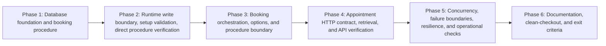

# 3 - Appointment Booking and Retrieval: Implementation plan

- Ticket: [[3 - Appointment Booking and Retrieval|Ticket 3]]
- Research: [[research/3/00-overview|Ticket 3 research overview]], with [[research/3/01-api-contracts-and-retrieval|API contracts and retrieval]], [[research/3/02-booking-procedure-and-concurrency|booking procedure and concurrency]], [[research/3/03-permissions-migrations-and-operations|permissions, migrations, and operations]], and [[research/3/04-verification-and-documentation|verification and documentation]].
- Requirement IDs: S3-01 through S3-06; acceptance labels AC3-01 through AC3-13 (research-local mappings to the ticket's thirteen unlabeled acceptance bullets; not new ticket IDs); verification cases T-01 through T-14 and T-16, plus S3-V01 through S3-V06; project requirements A-01, A-02, A-03, P-01, P-04, and D-01 through D-04.
- Plan structure: complex multi-phase plan under `docs/plans/3/` because ticket 3 has six requirements, thirteen acceptance criteria, four research parts, and API, scheduling, persistence-write, migration, runtime-permission, configuration, concurrency, operations, and documentation layers.

> [!IMPORTANT]
> This plan was verified on 2026-11-01 and passes the planning gate; see Verification. Every planned test is **Not run** and implementation has not started: the booking endpoints, procedure, grants, and records do not exist yet. This document does not establish implementation, executed tests, Swagger output, Compose behavior, or ticket acceptance.

## Scope and assumptions

- The accepted decisions in [[research/3/00-overview#Phase 5: Consolidated gap register|the research gap register]] (O-01 through O-24) and the part-level resolutions (A3, P3, M3, and V3) are the planning contract; this plan does not reopen them.
- The ticket owns booking confirmation and dealership-scoped retrieval plus the supporting procedure, runtime write boundary, migration, setup validation, bounded allocation, and verification. Authentication, cancellation/rescheduling, idempotent POST, vehicle-overlap protection, external integrations, telemetry infrastructure, and a custom UI remain excluded.
- Fixed contracts: `dbo.CreateAppointment` with the parameters, outputs, and errors `51001`-`51006`; `capacity_unavailable` for `409`; the documented POST/GET property names and `201` `Location`; `Scheduler:Booking` defaults `MaxCandidateAttempts=5`, `MaxDeadlockRetries=2`, `RetryDelayMilliseconds=50`, `RequestBudgetSeconds=20`, and `CommandTimeoutSeconds=10`; technician-then-bay locking under one short `SERIALIZABLE` transaction; no EF automatic write retries; no Redis or availability result as reservation authority.
- Time policy is fixed by the research and preserves AS-03-AS-06: `startsAt` requires `Z`/`z` or an explicit numeric offset, is normalized to UTC, and must be strictly future relative to the API `TimeProvider` and each attempt's evaluation instant. The full interval must fit one opening row and one technician shift in dealership-local wall-clock time; shifts and half-open `[start, end)` conflicts remain UTC; an end exactly at closing/shift end is allowed; adjacent opening/shift rows are never combined.
- Customer/vehicle ownership is validated through the existing `Vehicles.CustomerId` relationship; customers and vehicles are not assigned an invented dealership relationship. Dealership scope applies to services, technicians, bays, and appointments.
- Booking reads authoritative SQL `ServiceTypes.DurationMinutes` and never reads the service-catalog cache. No cache key, payload, TTL, or invalidation change is planned.
- Tests are written and executed inside their owning phase, not deferred to a final phase. The orchestrator `test` phase later generates `docs/test/3-manual-test.md` only; it does not supply automated evidence.
- `docs/test/3-test.md` is created in Phase 1 and extended with actual commands and observed results as each phase completes. `docs/deploy-notes/3-deploy-notes.md` is created in Phase 2 and finalized in Phase 6. Prior ticket reports remain baselines and are not rewritten.
- Only isolated local SQL Server, real Redis where relevant, and synthetic data are used. The configured `sqlserver` MCP server is unavailable in this session and is not required by the plan; Testcontainers/Compose provide the project dependencies.
- Existing tests are not rerun at plan time; ticket 3-preparation does not establish ticket 1 or ticket 2 results. Implementation records actual baseline and affected-suite results in the ticket 3 test report.

## Evidence baseline

- Research verification: **Passed** for planning on 2026-11-01, recorded in [[research/3/00-overview#Verification|the research overview Verification section]].
- Freshness check at plan creation: the LF-normalized SHA-256 values for the ticket and all five research files matched the research-verification table exactly; the research verification is current for the plan inputs.
- Checkout at plan creation: HEAD `90a62840d04756e1ec3c28bdc64ba53365be282f` on `main`; the 2026-11-01 ticket 3 update and the five research files are staged. The planning change adds this plan and updates `docs/README.md`; it does not modify the verified ticket or research inputs.
- Toolchain observed during research and not re-executed by planning: .NET SDK `10.0.403`, Docker `25.0.3`, SQL Server 2022 CU23 image, xUnit v3, WebApplicationFactory, Testcontainers.MsSql/Redis, and `Microsoft.Extensions.TimeProvider.Testing`. Implementation must re-verify actual versions and record them.
- Existing code paths inspected for this plan: `Program.cs` composition root and Problem Details customization; `ProblemCodes`, `ProblemResponse`, `SqlFailureClassifier`, `SqlDependencyExceptionHandler`; `AvailabilityQueries`, `AvailabilityService`, `StartsAtParser`, `AvailabilityInterval`, `OpeningCoverage`; `RuntimePrincipalProvisioner` and `DatabaseSetupRunner`; `AppointmentConfiguration`, `SeedData`, `SchedulerDbContext`; `SchedulerApiFactory`, `SqlServerTestBase`, `CacheSqlServerTestBase`, `SchedulingTestData`, and `SqlServerContainerFixture`.
- Planned paths and commands remain labelled as planned until implementation creates and executes them.

## Planned repository layout

Existing paths were inspected; **new** paths are proposed additions, and **modify** paths exist today.

```text
src/ServiceScheduler.Api/
  Program.cs                                                   # modify: booking options, procedure boundary, service registration
  appsettings.json                                             # modify: Scheduler:Booking defaults
  Features/Appointments/                                       # new
    AppointmentsController.cs
    AppointmentService.cs
    BookingOptions.cs
    BookingOptionsValidator.cs
    BookingCandidatePlanner.cs
    BookingAllocator.cs
    AppointmentBookingOutcome.cs                               # feature-local result records
    Contracts/CreateAppointmentRequest.cs
    Contracts/AppointmentResponse.cs
  Infrastructure/Persistence/
    Entities/TimeZoneMapping.cs                                # new
    Configurations/TimeZoneMappingConfiguration.cs             # new
    Configurations/DealershipConfiguration.cs                  # modify: mapping FK
    Configurations/SeedData.cs                                 # modify: TimeZoneMappings seed
    SchedulerDbContext.cs                                      # modify: TimeZoneMappings DbSet
    IAppointmentBookingProcedure.cs                            # new
    SqlAppointmentBookingProcedure.cs                          # new
  Infrastructure/Setup/
    TimeZoneMappingValidator.cs                                # new
    DatabaseSetupRunner.cs                                     # modify: validate mapping/procedure after migrations
    RuntimePrincipalProvisioner.cs                             # modify: EXECUTE grant and appointment DML denies
  Infrastructure/Errors/ProblemCodes.cs                        # modify: capacity_unavailable
  Infrastructure/OpenApi/ApiOperationTransformer.cs            # modify: POST/GET documentation
  Infrastructure/OpenApi/ProblemDetailsSchemaTransformer.cs    # modify: code list
  Migrations/<timestamp>_AddBookingProcedureAndTimeZoneMappings.cs  # new, actual ID generated
  Migrations/SchedulerDbContextModelSnapshot.cs                # modify
tests/ServiceScheduler.UnitTests/Booking/                      # new
  BookingOptionsValidatorTests.cs
  BookingCandidatePlannerTests.cs
  BookingAllocatorTests.cs
  FakeAppointmentBookingProcedure.cs
tests/ServiceScheduler.IntegrationTests/Booking/               # new
  AppointmentApiTests.cs
  AppointmentValidationTests.cs
  AppointmentEligibilityTests.cs
  AppointmentIntervalTests.cs
  AppointmentDstTests.cs
  AppointmentDurationTests.cs
  BookingProcedureTests.cs
  BookingConcurrencyTests.cs
  BookingFailureBoundaryTests.cs
  BookingSetupTests.cs
  BookingMigrationTests.cs
  BookingMigrationUpgradeTests.cs
  BookingOutageTests.cs
tests/ServiceScheduler.IntegrationTests/Fixtures/BookingProcedureInvoker.cs  # new test helper
tests/ServiceScheduler.IntegrationTests/Fixtures/FakeAppointmentBookingProcedure.cs  # new test double for API failure mapping
tests/ServiceScheduler.IntegrationTests/Fixtures/SchedulingTestData.cs       # modify: booking probe helpers
tests/ServiceScheduler.IntegrationTests/Persistence/MigrationAndSeedTests.cs # modify
tests/ServiceScheduler.IntegrationTests/Security/RuntimePermissionTests.cs   # modify
tests/ServiceScheduler.IntegrationTests/OpenApi/OpenApiTests.cs              # modify
tests/ServiceScheduler.IntegrationTests/Startup/ProblemDetailsTests.cs       # modify
docs/test/3-test.md                                            # new in Phase 1; extended per phase
docs/deploy-notes/3-deploy-notes.md                            # new in Phase 2; finalized in Phase 6
README.md, docs/architecture.md, docs/setup-guide.md, docs/database/*.md, docs/README.md  # modify in Phase 6
```

No second host, generic repository/unit-of-work, background job, new cache, new telemetry stack, new container, or new package is planned. `Microsoft.Data.SqlClient` is already available to the API through the EF Core SQL Server dependency; add an explicit pin only if the build or analyzers require it.

## Dependency graph



The dependency is intentional: a successful runtime `POST` must not be planned or verified before the procedure and restricted write boundary exist. Phase 2 proves the protected SQL write path with an independent runtime connection; Phase 4 exposes it through HTTP; Phase 5 proves the concurrency and failure bounds. Phase 6 records final behavior only after all required checks pass.

## Phase index

| Phase | File | Requirements | Depends on | Exit evidence |
| --- | --- | --- | --- | --- |
| 1 | [[plans/3/phase-1-database-foundation\|Database foundation and booking procedure]] | S3-02, S3-03, S3-06; AC3-03, AC3-05, AC3-13 migration portions; project A-02, A-03, P-01 | Research verification and the ticket 2 schema baseline | Migration applies to an empty database and a ticket 2 database; `TimeZoneMappings`, its FK/unique index, and `dbo.CreateAppointment` exist; existing appointments survive; down migration drops the new objects and preserves appointments; model snapshot/migration script inspected. |
| 2 | [[plans/3/phase-2-runtime-write-boundary\|Runtime write boundary, setup validation, and direct procedure verification]] | S3-02, S3-03, S3-06; AC3-03, AC3-05, AC3-13; T-04, T-05, T-06, T-08, T-09, T-10/T-11 direct-call portions; S3-V05, S3-V06; project P-01, P-04 | Phase 1 | Fresh, repeated, and ticket 2-upgrade setup apply the exact runtime `EXECUTE` grant and appointment DML denies; direct DML is denied; direct runtime procedure calls enforce ownership, scope, duration, eligibility, coverage, future start, and both conflicts; failures leave no row and release locks; mapping/DST validation runs at setup. |
| 3 | [[plans/3/phase-3-booking-orchestration\|Booking orchestration, options, and procedure boundary]] | S3-01 through S3-04; AC3-02, AC3-03, AC3-12; T-02/T-03 unit portions; S3-V03, S3-V04; project A-01, A-02, A-03, P-01 | Phase 2 | Booking options validate; the candidate planner is deterministic and bounded; the allocator's fake-boundary tests cover success, alternative pairs, 51001-51006 mapping, deadlock retries, timeouts, budget, cancellation, and unknown-commit no-replay; the SQL procedure boundary is implemented with typed outputs and command timeout, with real execution verified in Phase 4. |
| 4 | [[plans/3/phase-4-appointment-api\|Appointment HTTP contract, retrieval, and API verification]] | S3-01, S3-02, S3-05; AC3-01, AC3-02, AC3-03, AC3-10, AC3-11; T-01 through T-06, T-10, T-11, T-14 restart portion; S3-V01, S3-V02, S3-V03, S3-V05 API portions; project A-01, A-02, A-03, D-01, D-02 | Phase 3 | POST `201` with `Location` and complete DTO; POST-then-GET equality and UTC `Z` timestamps; `400`/`404`/`409` validation and capacity matrix; adjacent/overlap and technician-only/bay-only API conflicts; DST/offset parity; stale catalog cannot change booking duration; GET uses stored snapshot and is dealership scoped; OpenAPI documents both operations. |
| 5 | [[plans/3/phase-5-concurrency-and-operations\|Concurrency, failure boundaries, resilience, and operational checks]] | S3-03, S3-04, S3-05, S3-06; AC3-04, AC3-06, AC3-07, AC3-08, AC3-12; T-07, T-13, T-14 outage portion, T-16 manual verification portion; S3-V04; project P-01, P-04, D-03, D-04 | Phase 4 | Twenty coordinated POSTs with one eligible pair produce exactly one `201`, nineteen `409`, and one row across two API factories; held-lock, command-timeout, cancellation, budget, and unknown-commit boundaries are verified; Redis outage leaves booking/retrieval correct; SQL outage prevents confirmation and fails readiness; the Compose stack is verified through documented manual checks. |
| 6 | [[plans/3/phase-6-documentation-and-exit\|Documentation, clean-checkout, and exit criteria]] | S3-06; AC3-01 through AC3-13 evidence consolidation; T-16 clean-checkout portion; project D-01 through D-04, P-04 | Phases 1-5 | README, architecture, setup guide, database schema/overview/migration/cache, documentation index, deploy notes, and test report reflect implemented behavior with actual commands and observed results; clean-checkout initialization, migration, seed, startup, booking/retrieval work; unexecuted or manual checks remain explicit; required failures block completion. |

## Requirement traceability

| Requirement | Ticket intent | Plan coverage |
| --- | --- | --- |
| S3-01 | Validated appointment creation with a complete persisted response and retrieval `Location` | Phases 3-4 controller/service/DTO/options; Phase 4 T-01/T-10/T-11 and S3-V01; Phase 6 records. |
| S3-02 | Authoritative full-interval eligibility, scoped relationships, duration snapshot, independent conflicts | Phase 1 duration/end constraints and procedure predates; Phase 2 direct-call parity; Phases 3-4 prechecks and eligibility/interval/duration tests; S3-V02/S3-V05. |
| S3-03 | Atomic allocation under concurrency through a restricted procedure write boundary | Phase 1 procedure; Phase 2 grants/denies; Phase 3 boundary/allocator; Phase 4 end-to-end and alternative-pair API (S3-V03); Phase 5 T-07 concurrency and S3-V06 upgrade. |
| S3-04 | Bounded candidate/deadlock handling, classified failures, cancellation, unknown-commit safety | Phase 3 options/planner/allocator unit tests; Phase 5 failure-boundary and outage tests; S3-V04. |
| S3-05 | Dealership-scoped retrieval independent of Redis | Phase 4 GET/controller/query and T-01/T-11/T-14 restart; Phase 5 Redis outage; S3-V01. |
| S3-06 | Automated verification, manual operational checks, OpenAPI, updated operational/database records | Phases 1-5 tests; Phase 4 OpenAPI; Phases 5-6 operations and documentation; T-16, S3-V06. |
| AC3-01 | Valid booking returns `201`, complete associations, survives restart | Phase 4 `AppointmentApiTests`; T-01/T-14 restart; Phase 6. |
| AC3-02 | Invalid ownership/scope/qualification/time/coverage/availability rejected without writes | Phase 2 direct-call tests; Phase 4 validation/eligibility/interval tests; S3-V05. |
| AC3-03 | Adjacent succeeds; partial/contained/identical and resource-only conflicts fail | Phase 2 direct procedure; Phase 4 API interval tests; T-04-T-06. |
| AC3-04 | 20 concurrent POSTs, one pair: one `201`, nineteen `409`, one stored | Phase 5 `BookingConcurrencyTests`; T-07. |
| AC3-05 | Independent runtime procedure calls reject overlaps; valid execution succeeds; direct writes denied | Phase 2 `BookingProcedureTests` and `RuntimePermissionTests`; T-08. |
| AC3-06 | Empty table, lock wait then fresh check, atomic rollback/released locks, bounded deadlock/timeout | Phases 2 and 5; T-07-T-09, S3-V04. |
| AC3-07 | Booking works during Redis outage; SQL outage prevents confirmation and fails readiness | Phase 5 `BookingOutageTests`; T-13/T-14. |
| AC3-08 | Booking checks use real seeded UUIDs and generated future times | Phase 5 checks; T-16 manual verification portion. |
| AC3-09 | Clean checkout startup/demo and README/design/database evidence | Phases 5-6; T-16 clean-checkout portion. |
| AC3-10 | DTOs, Location, UTC, Problem Details, and strict input handling match the contract | Phase 4 `AppointmentApiTests`/`AppointmentValidationTests`/`OpenApiTests`/`ProblemDetailsTests`; S3-V01. |
| AC3-11 | Catalog duration changes do not alter existing appointments; stale cache cannot affect booking; availability sees committed rows | Phase 4 `AppointmentDurationTests`; S3-V02. |
| AC3-12 | Alternative-pair allocation, cancellation, unknown-commit bounds without unsafe replay | Phase 3 allocator tests; Phase 5 failure boundaries; S3-V03/S3-V04. |
| AC3-13 | Fresh/repeated/ticket 2-upgrade setup applies procedure and permissions; recovery documented and verified | Phases 1-2 migration/setup/permission tests; Phase 6 deploy notes. |
| A-01, A-02, A-03 | Booking, availability rules, persistence/retrieval integrity | Phases 1-5; P-01 boundary. |
| P-01 | Atomic booking and concurrent allocation integrity | Phases 1-3 and 5. |
| P-04 | Verification and documentation discipline | Every phase's test-report updates; Phase 6 exit review. |
| D-01-D-04 | Architecture, API contract, setup, and database documentation | Phase 4 OpenAPI and Phase 6 records; operational evidence from Phase 5. |

## Verification case assignment

| Case | Owning phase | Primary target | Requirements |
| --- | --- | --- | --- |
| T-01 Valid future booking | Phase 4 | `Booking/AppointmentApiTests.cs` | A-01, A-02, A-03 |
| T-02 Qualification or inactive resource | Phases 3-4 | `Booking/BookingCandidatePlannerTests` (policy) and `Booking/AppointmentEligibilityTests.cs` | A-02 |
| T-03 Partial shift/opening coverage | Phases 3-4 | Planner/coverage unit checks and `AppointmentEligibilityTests.cs` | A-02 |
| T-04 Interval boundaries | Phases 2 and 4 | `BookingProcedureTests.cs` (adjacent/overlap direct) and `AppointmentIntervalTests.cs` | A-02, P-01 |
| T-05 Technician conflict only | Phases 2 and 4 | `BookingProcedureTests.cs` (51001) and `AppointmentIntervalTests.cs` | P-01 |
| T-06 Bay conflict only | Phases 2 and 4 | `BookingProcedureTests.cs` (51002) and `AppointmentIntervalTests.cs` | P-01 |
| T-07 Concurrent competition | Phase 5 | `Booking/BookingConcurrencyTests.cs` | P-01 |
| T-08 Database write boundary | Phase 2 | `Booking/BookingProcedureTests.cs` and extended `Security/RuntimePermissionTests.cs` | P-01 |
| T-09 Atomic failure | Phase 2 | `Booking/BookingProcedureTests.cs` | A-03, P-01 |
| T-10 Time handling | Phases 2 and 4 | Existing parser/interval unit tests; direct offset/DST in `BookingProcedureTests`; `AppointmentValidationTests`/`AppointmentDstTests` | A-01, A-02 |
| T-11 Relationship and scope | Phases 2 and 4 | Direct `51003`/`51004` checks and `AppointmentValidationTests`/`AppointmentApiTests` retrieval | A-01, A-03 |
| T-13 Booking during Redis outage | Phase 5 | `Booking/BookingOutageTests.cs` | P-01 |
| T-14 Restart and database outage | Phases 4-5 | Restart retrieval in `AppointmentApiTests`; SQL/readiness outage in `BookingOutageTests` | A-03, P-04 |
| T-16 Booking clean checkout | Phases 5-6 | README/setup clean-checkout checks and existing integration tests | D-02, D-03, D-04, P-04 |
| S3-V01 API contract | Phase 4 | `AppointmentApiTests`, `AppointmentValidationTests`, `OpenApiTests`, `ProblemDetailsTests` | S3-01, S3-04, S3-05 |
| S3-V02 Duration and read compatibility | Phase 4 | `Booking/AppointmentDurationTests.cs` with real Redis | S3-02, S3-05 |
| S3-V03 Alternative candidates | Phases 3-4 | `BookingAllocatorTests` (fake first-pair conflict then success) and a blocked-first-candidate API test | S3-03, S3-04 |
| S3-V04 Failure boundaries | Phases 3 and 5 | Allocator failure tests; `Booking/BookingFailureBoundaryTests.cs` | S3-03, S3-04 |
| S3-V05 Direct-call validation parity | Phases 2 and 4 | `BookingProcedureTests` direct calls including offset/DST; `AppointmentDstTests` API parity | S3-02, S3-03 |
| S3-V06 Setup and recovery | Phases 1-2 and 6 | `BookingMigrationTests`, `BookingSetupTests`, `BookingMigrationUpgradeTests`, extended permission tests; deploy notes | S3-03, S3-06 |

## Verification commands and identities

Commands are planned from the repository root and become authoritative once the files exist.

| Purpose | Planned command |
| --- | --- |
| Restore/build | `dotnet restore` then `dotnet build --no-restore` |
| Format | `dotnet format --verify-no-changes` |
| Booking unit tests | `dotnet test tests/ServiceScheduler.UnitTests/ServiceScheduler.UnitTests.csproj --no-build --filter "FullyQualifiedName~Booking"` |
| Booking integration tests | `dotnet test tests/ServiceScheduler.IntegrationTests/ServiceScheduler.IntegrationTests.csproj --no-build --filter "FullyQualifiedName~Booking"` |
| Full regression | `dotnet test tests/ServiceScheduler.UnitTests/ServiceScheduler.UnitTests.csproj --no-build` and `dotnet test tests/ServiceScheduler.IntegrationTests/ServiceScheduler.IntegrationTests.csproj --no-build` |
| Migration inspection | `dotnet tool restore` then `dotnet ef migrations script --project src/ServiceScheduler.Api/ServiceScheduler.Api.csproj --startup-project src/ServiceScheduler.Api/ServiceScheduler.Api.csproj` |
| Compose validation/startup | `docker compose config`, `docker compose up -d --wait`, `docker compose logs db-setup`, `docker compose logs api` |
| Health | `Invoke-WebRequest http://127.0.0.1:8080/health/live` and `http://127.0.0.1:8080/health/ready` |
| Redis outage | `docker compose stop redis`, run booking/retrieval, then `docker compose start redis` |
| SQL outage | Use an unreachable runtime connection or a dedicated isolated stopped-container check; never stop the shared test container while other tests run. |

- Identities: migrations, seeds, and probe-row cleanup use the privileged setup identity from `ConnectionStrings:Setup`; API calls, direct procedure calls, permission denials, and concurrency tests use `scheduler_app` from `ConnectionStrings:Runtime`. Tests never grant direct appointment writes to bypass a failure.
- Dependencies: real SQL Server 2022 CU23 through the existing Testcontainers fixture for procedure, locking, permission, migration, and concurrency checks; real Redis through the existing fixtures for cache-staleness and outage checks. EF in-memory and SQLite are not substitutes.
- Time: the fixed fixture clock `2026-11-02T00:00:00Z` with generated/seed-covered future starts; direct procedure calls supply an explicit `@EvaluatedAtUtc`. Do not hardcode an only-expiring date in documentation examples.
- Evidence: every executed scenario records revision, environment, dependency versions, command, expected vs observed, and Passed/Failed/Blocked/Not run in `docs/test/3-test.md`. A generated checklist or a successful build does not mark acceptance criteria Passed.

## Cross-phase constraints

- The procedure is same-owner `dbo.CreateAppointment`, static, parameterized, and free of dynamic SQL; it owns its transaction, rejects a caller-owned transaction with `51003`, sets `XACT_ABORT ON`, `SERIALIZABLE`, and `LOCK_TIMEOUT 5000`, locks the technician row then the bay row with `UPDLOCK, HOLDLOCK`, revalidates every invariant, checks both half-open conflicts independently, inserts one `Confirmed` row, and commits before returning.
- The procedure's final migration SQL must guarantee session-state reset on every exit, including early validation failures. Prefer placing early validation inside the same `TRY`/`CATCH` or explicitly restoring `XACT_ABORT`/`LOCK_TIMEOUT`/isolation before returning.
- SQL opening validation uses `Dealerships.TimeZoneId` → `TimeZoneMappings.IanaId` → `WindowsId` with `AT TIME ZONE`. A missing or invalid mapping is `51006`; setup validation treats it as a configuration failure. The local interval must fit one opening row and one shift; an end exactly at closing/shift end is allowed; adjacent rows are never combined.
- The API validates `startsAt` syntactically before conversion, captures `evaluatedAt` from `TimeProvider`, and never supplies client-chosen technician, bay, duration, end time, or creation time. The procedure receives a fresh per-attempt `@EvaluatedAtUtc` immediately before each attempt.
- Known procedure errors are handled in the booking boundary before the global SQL handler: `51001`/`51002` skip the conflicted resource; `51004`/`51005` skip only the pair; `51003` maps to `400 validation_error` on the API path because the API never owns a transaction; `51006` maps to sanitized `500 internal_error`; `1205` retries the whole rolled-back attempt within the global bound; `1222`, `-2`, and classified connectivity errors map to `503 dependency_unavailable` with no replay.
- `MaxCandidateAttempts` counts distinct candidate pairs; a deadlock retry re-executes the same pair and is bounded separately by `MaxDeadlockRetries`. Exhausted pairs return `409 capacity_unavailable`; non-exhaustive capacity discovery is documented.
- Request cancellation propagates as cancellation; it is not converted into a dependency failure. Cancellation after commit may leave a confirmed appointment; the API does not replay the write, a later GET may reveal the appointment, and idempotency remains out of scope.
- `405`/`415` remain framework routing/media errors outside the documented booking outcome matrix; no application code is added for them. Every mandatory booking outcome, including framework model-state `400`, carries `code` and `traceId`.
- Booking never opens an EF transaction, never enables `EnableRetryOnFailure` for the write path, never uses `NOLOCK`, snapshot reads, Redis/process locks, unique start keys, or an EF concurrency token as the overlap defense.
- Availability remains advisory and unchanged. Booking reuses `StartsAtParser`, `AvailabilityInterval`, `OpeningCoverage`, and `AvailabilityQueries` in place; no behavior-preserving extraction is required. The procedure remains the authority for confirmation.
- Runtime permissions are exactly database `CONNECT`, schema `dbo` `SELECT`, object `EXECUTE` on `dbo.CreateAppointment`, and object `DENY INSERT/UPDATE/DELETE` on `dbo.Appointments`; no schema `EXECUTE`, direct write grants, DDL, ownership, or roles. The runtime login/user/SID/role checks remain.
- The service-catalog cache key, payload version, TTL, and invalidation rules remain unchanged; booking never reads Redis. Committed appointments are visible to later uncached availability because it queries SQL.
- `docs/test/3-test.md` is the only home for executed ticket 3 evidence; research probes remain design support and do not satisfy T/S3-V cases. `docs/test/3-manual-test.md` is generated later and starts Not run.

## Database, cache, configuration, and deployment impact

- Database impact: **yes**. Add `dbo.TimeZoneMappings` (`IanaId nvarchar(100)` primary key, `WindowsId nvarchar(100)` required with unique index), seed `Asia/Ho_Chi_Minh → SE Asia Standard Time` and `Europe/London → GMT Standard Time`, add `FK_Dealerships_TimeZoneMappings_TimeZoneId`, and create `dbo.CreateAppointment`. No `Appointments` column, check, FK, or index change is expected; the existing technician/bay/start indexes include `EndUtc`/`Status`. The actual migration ID is generated during Phase 1 and recorded in [[database/migration|Migrations]].
- Cache impact: **none**. Booking reads `ServiceTypes.DurationMinutes` directly from SQL; retrieval reads the appointment table; availability remains uncached. No catalog key, payload, serialization version, TTL, or invalidation change. Phase 6 records this reason in [[database/cache|Cache]].
- Runtime permissions impact: **yes**. Add object `EXECUTE` and explicit appointment DML denials while retaining `CONNECT` and schema `SELECT`; migrations/seeds continue with the privileged setup identity.
- Configuration impact: new `Scheduler:Booking` options with non-secret defaults; startup validation fails on invalid values. No new secret, container, or package.
- Deployment impact: fresh setup, repeated setup, ticket 2 upgrade, runtime permission recovery, and procedure/mapping recovery require `docs/deploy-notes/3-deploy-notes.md`. No data backfill or appointment rewrite is planned.
- Telemetry: existing `ILogger` only; Serilog/OpenTelemetry remains ticket 4.

## Rollback or forward recovery

| Area | Recovery action | Limits |
| --- | --- | --- |
| Schema downgrade | Apply the ticket 3 migration down (or `dotnet ef database update 20261031092016_InitialCreate`) with the privileged setup identity. | Drops the procedure, mapping FK, and mapping table; existing appointments remain. A down migration does not restore deleted appointment data. |
| Runtime permissions after downgrade | Revoke the ticket 3 object permissions, then rerun the ticket 2 provisioner or recreate the local database. Verify actual permission rows after the down migration because object-level permissions on dropped objects may disappear with the object, while the appointment DML `DENY` references the surviving table. | Required before a ticket 2 setup version can pass its allowlist; otherwise setup fails on unexpected permissions. |
| Application rollback | Redeploy the previous API version and remove `Scheduler:Booking` configuration. | Previous version has no booking endpoints; existing appointments remain readable only by direct SQL/admin access. |
| Forward recovery | Fix the mapping/procedure/grants/setup validator and rerun `--db-setup`; migrations are transactional and repeated setup is idempotent. | Preferred for a partially failed setup; no appointment data loss for additive changes. |
| Destructive local reset | `docker compose down -v` then `docker compose up -d --wait` only after explicit confirmation for the isolated local environment. | Removes all local synthetic data, including appointments. Retest setup after reset. |

## Overall progress

| Phase | Plan | Implementation | Verification |
| --- | --- | --- | --- |
| 1 | Verified 2026-11-01 | Not started | Not run |
| 2 | Verified 2026-11-01 | Not started | Not run |
| 3 | Verified 2026-11-01 | Not started | Not run |
| 4 | Verified 2026-11-01 | Not started | Not run |
| 5 | Verified 2026-11-01 | Not started | Not run |
| 6 | Verified 2026-11-01 | Not started | Not run |

Implementation and verification status remain separate. A completed step without executed checks remains unverified; actual commands and observed results belong in [[test/3-test|the ticket 3 test report]] once implementation begins.

## Verification

- Command: `/orchestrator-ticket verify plan 3`.
- Status: **Passed** for implementation planning.
- Verified on: 2026-11-01.
- Checkout: HEAD `90a62840d04756e1ec3c28bdc64ba53365be282f` on `main`; the ticket 3 update and five research files are staged, this plan is untracked, and `docs/README.md` has staged plus working-tree index updates. Planning and verification did not modify the ticket or research inputs.
- Research verification: **Passed** on 2026-11-01; the current research fingerprints below match [[research/3/00-overview#Verification|the research Verification record]].
- Input fingerprints (SHA-256 of LF-normalized content; the plan overview fingerprint covers the plan content before this Verification section; this section is the verification record, not a plan step):

| Input | Fingerprint |
| --- | --- |
| `docs/tickets/3 - Appointment Booking and Retrieval.md` | `7491ee3a8503690f420b191397deb094a67796f15f0ed1d716a8e8d6b3e0a3a9` |
| `docs/research/3/00-overview.md` (pre-Verification content) | `e05f569734849c1123fce6b160cb7436255d33b1ad2ad5b403d2d1546f5bb149` |
| `docs/research/3/01-api-contracts-and-retrieval.md` | `3fa887b5e77e37a6242cb32523fc441774dcfe4a6a81c4c7062a38f69a87191c` |
| `docs/research/3/02-booking-procedure-and-concurrency.md` | `9927f7e2832e7afdc28207a11abeafd0b8d264f265a275e2b6f6af79bbb25350` |
| `docs/research/3/03-permissions-migrations-and-operations.md` | `5aa707f56826a883714eca94781585d258daed557b22a67394b509777c2e7dd8` |
| `docs/research/3/04-verification-and-documentation.md` | `d1328b949911de8e9800ad061fc20b0309f8144c64134ba56287330cd65ef08f` |
| `docs/plans/3/README.md` (pre-Verification content) | `0b98ffd815e352ba92b8eca1da5dbf77239bebd69517e769c1a7e41abeb9ec80` |
| `docs/plans/3/phase-1-database-foundation.md` | `91b0c5679f67af59f6a6a05b5cc7fde286479d3797d7dab026d2b100439d6f5e` |
| `docs/plans/3/phase-2-runtime-write-boundary.md` | `ecd082c3317325d65eeb39d17b7cde270aa241b40862ffb720b207d37fb6b290` |
| `docs/plans/3/phase-3-booking-orchestration.md` | `99e961871695eb4414adf0eacf51a113afe18bf59b7eb28a82e958b0a6253524` |
| `docs/plans/3/phase-4-appointment-api.md` | `48c1b6373a07fa43c1339df0ded8acac44bcba8841a0298bc11937f16c5bf270` |
| `docs/plans/3/phase-5-concurrency-and-operations.md` | `99b6d220c4f3ab8a43bf271d69789509c9404d437c130c39ed685f2de4adda6f` |
| `docs/plans/3/phase-6-documentation-and-exit.md` | `b217a8ccac22337cedf631a6eb2e36fff45c34b69fd6bf6cb4cfbfb20b663dfc` |

- Forward trace: every S3-01-S3-06 requirement, the ticket's thirteen acceptance bullets (mapped to AC3-01-AC3-13), every ticket-defined T-series case present in the ticket (T-01-T-11, T-13, T-14, T-16; the ticket defines no T-12 or T-15), and every S3-V01-S3-V06 case has an owning phase, test/file target, and exit evidence in the overview and phase files.
- Requirement traceability:

| Requirement group | Plan coverage | Result |
| --- | --- | --- |
| S3-01, AC3-01, AC3-02, AC3-10 | Phases 3-4; T-01, T-10, T-11, S3-V01 | Covered |
| S3-02, AC3-02, AC3-03, AC3-11 | Phases 1-4; T-02-T-06, S3-V02, S3-V05 | Covered |
| S3-03, AC3-03-AC3-06, AC3-12 | Phases 1-5; T-04-T-09, S3-V03, S3-V04, S3-V06 | Covered |
| S3-04, AC3-06, AC3-12 | Phases 3 and 5; T-07-T-09, S3-V04 | Covered |
| S3-05, AC3-01, AC3-07, AC3-10 | Phases 4-5; T-01, T-11, T-13, T-14, S3-V01 | Covered |
| S3-06, AC3-07-AC3-13 | Phases 1-6; T-08, T-13, T-14, T-16, S3-V06 | Covered |
| T-01-T-11, T-13, T-14, T-16 | Verification case assignment and phase verification tables | Covered |
| S3-V01-S3-V06 | Verification case assignment and phase verification tables | Covered |
| A-01-A-03, P-01, P-04, D-01-D-04 | Requirement traceability and phase exits | Covered |

- Reverse trace: every phase step and planned file supports a ticket requirement or a necessary dependency. The plan introduces no new requirement IDs; it uses ticket IDs plus the research-local AC3-01-AC3-13 labels for the ticket's thirteen unlabeled acceptance bullets and references the research decision register (O-01-O-24). Exclusions preserve the ticket boundaries: no authentication, cancellation/rescheduling, idempotent POST, vehicle-overlap protection, telemetry stack, custom UI, cache change, or new container/package. The plan does not weaken the local-demo, synthetic-data, runtime-permission, or real-dependency-verification constraints.
- Phase/file check: the overview and all six indexed phase files exist with matching filenames; the dependency graph and phase index agree on the Phase 1 -> Phase 2 -> Phase 3 -> Phase 4 -> Phase 5 -> Phase 6 order; no cycle exists; each phase has its own implementation, verification, and exit criteria. The booking POST slice is correctly gated behind the Phase 1 procedure and Phase 2 protected runtime write boundary.
- Call-path check: the plan's existing-file claims match inspected code: `Program.cs` has no booking registration or EF retry strategy; `RuntimePrincipalProvisioner.ValidateDatabasePermissionsAsync` currently allows only `CONNECT` and schema `SELECT`; `DatabaseSetupRunner` runs migrations -> provisioner -> shift seeder; `AvailabilityQueries.ServiceLookups`, `TechnicianCandidates`, and `BayCandidates` have the stated scopes, predicates, ordering, and shared-query shapes; `AppointmentConfiguration` has the duration/end/status/UTC checks and technician/bay/start indexes with `EndUtc`/`Status`; `SeedData` has the stated IDs, IANA zones, weekday opening hours, and one active technician/bay per dealership; `ProblemCodes` has no `409`; the OpenAPI transformers cover only ticket 2; the test fixtures expose the setup/runtime connections, fixed clock, database-per-class, factory overrides, Redis pause/unpause, and probe helpers used by the plan. Proposed new files are labelled as additions, not existing code.
- Test/check assignment: every required unit, API, integration, real-SQL, real-Redis, concurrency, and operational scenario has an implementation step and phase exit evidence. Execution is owned by implementation in each phase, not deferred to the orchestrator `test` phase; the manual supplemental checks remain separate and Not run. The plan explicitly permits no successful runtime POST before the procedure and restricted write boundary exist.
- Database/cache/permissions/deployment impact: the database impact is the additive `TimeZoneMappings` table/seed/FK and `dbo.CreateAppointment`, with no appointment column/index change; the actual migration ID is correctly deferred to Phase 1. Cache impact is none, with the reason recorded. Runtime permissions are the exact `CONNECT`, schema `SELECT`, object `EXECUTE`, and appointment DML `DENY` set. Booking options are non-secret and validated. Per-ticket deploy notes, rollback/revoke, and recovery are planned in Phases 2 and 6. These follow [[rules/conventions|the scheduler conventions]] and [[database/maintenance|database maintenance]]; no planned command is presented as executed.
- Corrections applied during verification: added S3-V03 alternative-pair API coverage to Phase 4's frontmatter, step 7, verification table, and traceability; added explicit T-02/T-03/T-10 unit-level mapping to the existing `Availability` unit tests and moved `AvailabilitySqlTests` generated-SQL predicate checks to Phase 4 integration-level evidence because that file is in the integration test project; added a resolvable-but-DST-inconsistent Windows mapping parity failure to the Phase 2 setup tests. The affected forward/reverse traces and IDs were rechecked; every ticket-defined ID now appears in the plan and no plan-only requirement was introduced.
- Unresolved dependencies and non-blocking observations: no blocking gap remains for planning. The actual migration ID is generated in Phase 1 and must be recorded then. SQL Server may leave a default `EXECUTE` grant to `public` on the procedure; Phase 2 must inspect and document the observed state without adding schema `EXECUTE` or a write grant. A true lost-commit-acknowledgment fault cannot be injected locally, so S3-V04 retains the fake-boundary no-replay test plus code inspection as the documented limitation. Manual checklist generation and human execution remain the later `/orchestrator-ticket test 3` phase. The 405/415 Problem Details interpretation remains documented and is not required by any booking acceptance criterion.
- Result: **Passed** for implementation planning. This record does not establish implementation, executed tests, Swagger output, Compose behavior, or ticket acceptance; AC3-01-AC3-13 and the T/S3-V checks must not be marked Passed from this document. The next phase is `/orchestrator-ticket implement 3` (or a selected phase after rechecking its prerequisites).

## Implementation status (post-verification)

> [!NOTE]
> Ticket 3 implementation completed on 2026-11-02 after the plan-verification gate. The plan-time callout and Overall progress table above describe the planning state; this section records the later implementation and execution state. All six phases were implemented, 133 unit and 154 integration tests passed, the isolated Compose startup plus smoke/concurrency/outage/restart checks passed, and the clean-directory/fresh-volume startup passed. Human execution of the generated manual checklist remains pending.

| Phase | Implementation | Verification |
| --- | --- | --- |
| 1 | Implemented | Migration/procedure/seed/upgrade/down tests passed; migration script inspected |
| 2 | Implemented | Runtime permission, setup validation, direct procedure, upgrade, and recovery tests passed |
| 3 | Implemented | Booking options/planner/allocator unit tests passed (35 booking tests) |
| 4 | Implemented | POST/GET contract, validation, eligibility, interval, DST, duration, OpenAPI, and Problem Details tests passed |
| 5 | Implemented | 20-way concurrency, lock/command timeout, cancellation, budget/no-replay, Redis/SQL outage passed |
| 6 | Implemented | Documentation updated; clean-directory/fresh-volume startup passed; manual checklist pending |

Evidence is recorded in [[test/3-test|the ticket 3 test report]] and [[deploy-notes/3-deploy-notes|the ticket 3 deployment notes]]. This implementation status does not establish human manual execution or final ticket acceptance.
