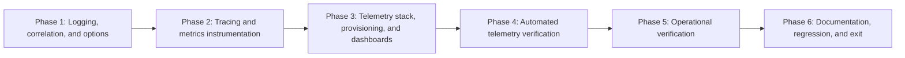

# 4 - Observability: Implementation plan

- Ticket: [[4 - Observability|Ticket 4]]
- Research: [[research/4/00-overview|Ticket 4 research overview]], with [[research/4/01-instrumentation-and-correlation|instrumentation and correlation]], [[research/4/02-telemetry-stack-and-dashboards|telemetry stack and dashboards]], and [[research/4/03-verification-workload-and-operations|verification and operations]].
- Requirement IDs: S4-01 through S4-06; acceptance labels AC4-01 through AC4-08 (research-local mappings to the ticket's eight unlabeled acceptance bullets; not new ticket IDs); verification cases T-13 and T-15, plus S4-V01 through S4-V03 and research scenario IDs TC4-01 through TC4-14, TC4-18, and TC4-19; project requirement P-03 and the booking/cache constraints P-01 and P-02.
- Plan structure: complex multi-phase plan under `docs/plans/4/` because ticket 4 has six requirements, eight acceptance criteria, three research parts, and application logging, tracing, metrics, configuration, container-stack, provisioning, automated-verification, operational and documentation layers.

> [!IMPORTANT]
> This plan was **verified** on 2026-11-02 and passes the planning gate; see Verification. Phases 1-6 were implemented on 2026-11-02: logging/correlation, tracing/metrics, the pinned telemetry stack and dashboards, real-backend telemetry tests, and documentation now exist. Automated/operational checks passed and are recorded in [[test/4-test|the ticket 4 test report]]. The manual checklist was generated 2026-11-02 as [[test/4-manual-test]] with all cases Not run; human execution and visual Grafana inspection remain pending. Direct Compose operational checks were executed manually and no standalone PowerShell script is required. The post-implementation notes below record actual outcomes and deviations.

## Scope and assumptions

- The accepted decisions in the research overview (O-01 through O-22), Part 1 (I4-01 through I4-10), Part 2 (K4-01 through K4-09), and Part 3 (V4-01 through V4-08) are the planning contract; this plan does not reopen them except where a decision below resolves a research-flagged planning gap.
- The ticket owns Serilog structured JSON console logging, OpenTelemetry traces and metrics over OTLP, a pinned Collector/Prometheus/Tempo/Grafana stack, provisioned dashboards/data sources, sensitive-data controls, bounded export behavior, and automated telemetry checks.
- Excluded: database schema/migration/procedure/permission changes, cache key/payload/TTL/invalidation changes, booking algorithm/locking/retry changes, centralized log storage or Loki, alerting, production hosting, authentication for telemetry UIs, a custom application UI, exemplars, and performance targets or availability guarantees.
- Telemetry is disabled by default outside Compose and telemetry tests. Serilog JSON console logging remains active when telemetry is disabled; OpenTelemetry providers, exporters, and instrumentation are registered only when `Scheduler:Telemetry:Enabled` is true.
- Telemetry must never become a booking or readiness dependency. `/health/live` and `/health/ready` keep their existing SQL/Redis-only semantics; no telemetry health check is added.
- The existing booking procedure, technician-then-bay lock order, bounded candidate/deadlock/retry behavior, request budget, cache budgets, SQL fallback, and restricted runtime write boundary remain unchanged. Instrumentation is synchronous local activity/counter work and asynchronous export; it adds no network wait inside a request or procedure attempt.
- No database or cache-contract change is planned. Prometheus/Tempo data lives in local named volumes; telemetry is not stored in SQL Server or Redis.
- Tests are written and executed inside their owning phase, not deferred to the orchestrator `test` phase. `docs/test/4-test.md` is the only home for executed ticket 4 evidence; the later `test` phase generates `docs/test/4-manual-test.md` for human execution and does not supply automated evidence.
- Only isolated local dependencies and synthetic data are used. Docker/Testcontainers are required for the telemetry and operational checks; a missing Docker daemon marks those checks Blocked, not Passed, while independent unit/contract checks continue.
- The configured `sqlserver` MCP server failed to connect in this session and is not required by the plan; migrations, queries, and verification use the repository's Testcontainers/Compose dependencies and local configuration.

### Plan decisions resolving research-flagged gaps

| Decision | Rationale | Requirement impact |
| --- | --- | --- |
| Filter `/health/live` and `/health/ready` from the request-completion event, `scheduler.http.requests`, and ASP.NET Core server spans. | Health probes are not business traffic and would distort request rate/latency/error panels; health behavior itself remains unchanged and is verified separately. | S4-01, S4-03, S4-05 |
| Record `scheduler.cache.operations` only for service-catalog request operations; `CacheHealthCheck` calls a non-recording path with its 1 s budget. | Counting the health key as a catalog `get` would corrupt the catalog hit ratio; the cache budget and readiness behavior stay unchanged. | S4-03, S4-05 |
| Record `scheduler.booking.outcomes` in `AppointmentsController.CreateAsync` for every documented POST outcome, including request-shape and `startsAt` parse failures. Escaped dependency/internal exceptions that bypass the controller are covered by `scheduler.http.requests{outcome=...}` and the dependency event. | Makes validation, capacity, success, and returned dependency outcomes visible without double counting; the request metric remains the fallback for exception paths. | S4-03, AC4-05 |
| Define the procedure-attempt `unexpected` vocabulary member for an unmapped exception raised by the procedure call, and record `dependency_unavailable` for a classified connection-open failure before the command executes. | The research vocabulary includes `unexpected`, but `BookingProcedureStatus` has no such member; the metric is recorded at the boundary and the exception is rethrown unchanged. | S4-03, S4-05 |
| Keep telemetry end-to-end tests in `tests/ServiceScheduler.IntegrationTests/Telemetry/` as dedicated test classes with a class-level telemetry-stack fixture and the existing SQL/Redis collection fixtures. | Reuses the real SQL Server, Redis, API factory, fixed clock, and synthetic data without duplicating or relocating fixtures; the dedicated classes and non-parallel collection keep container lifecycle and runtime behavior isolated. A separate test project remains an acceptable alternative if implementation finds a concrete isolation problem. | S4-06 |
| Use a 30-second bounded observation window as the default for delivery/recovery polling; implementation records the actual chosen window and measured result. | The research proposes 30 seconds as a planning default, not an observed guarantee. | S4-06, S4-V01 |
| Keep the catalog hit ratio transport-level and document that a corrupt payload counts as a `get` hit before fallback; the cache-operations panel distinguishes misses and failures. | Avoids inventing a second counter outside the research contract while making the ratio's meaning explicit. | S4-03, AC4-05 |
| Treat metric-name translation (`scheduler_*_total`, `*_seconds_bucket`) as a smoke-test assertion before dashboards are considered verified; adjust the dashboard if the pinned stack translates differently. | Research flags translation as an implementation verification item. | S4-03, S4-04 |

## Evidence baseline

- Research verification: **Passed** for planning on 2026-11-02, recorded in [[research/4/00-overview#Verification|the research overview Verification section]].
- Freshness check at plan creation: the LF-normalized SHA-256 values for the ticket and all four research entry/part files matched the research-verification table exactly. The research verification is current for these plan inputs.
- Checkout at plan creation: HEAD `92a81efde5dac1070669fff13193e452dc9b6529` on `main`; the four research files are untracked working-tree additions and `docs/README.md` is modified. Planning adds this plan and updates `docs/README.md`; it does not modify the verified ticket or research inputs.
- Toolchain observed during research and not re-executed by planning: Windows 11, .NET SDK `10.0.403`, Docker server `25.0.3`, Docker Compose `v2.24.6-desktop.1`, xUnit v3, WebApplicationFactory, Testcontainers 4.14.0 modules, SQL Server 2022 CU23, Redis `7.4.12-alpine`.
- Existing implementation inspected for this plan: `Program.cs` composition root and Problem Details customization; `ProblemCodes`, `ProblemResponse`, `SqlDependencyExceptionHandler`, `ProblemDetailsSchemaTransformer`, `ApiOperationTransformer`; `BoundedCache`, `CacheOptions`, `CacheReadResult`, `CacheHealthCheck`, `ServiceCatalogService`, `ServiceCatalogCacheKeys`; `AvailabilityService`; `AppointmentsController`, `AppointmentService`, `BookingAllocator`, `SqlAppointmentBookingProcedure`; `SchedulerApiFactory`, `SqlServerContainerFixture`, `SqlServerTestBase`, `CacheSqlServerTestBase`, `RedisContainerFixture`, `CapturingLoggerProvider`, `SchedulingTestData`; `Directory.Packages.props`, project files, `compose.yaml`, `.env.example`, `appsettings.json`, `appsettings.Development.json`, Dockerfile; README, architecture, setup-guide, test/deploy-note guides and prior ticket records.
- Planned paths and commands remain labelled as planned until implementation creates and executes them. Research-phase container probes validate configuration shapes only and do not satisfy any ticket check.

## Planned repository layout

Existing paths were inspected; **new** paths are proposed additions, and **modify** paths exist today.

```text
Directory.Packages.props                                      # modify: Serilog/OpenTelemetry/Testcontainers/SqlClient pins
src/ServiceScheduler.Api/ServiceScheduler.Api.csproj          # modify: Serilog/OpenTelemetry package references
src/ServiceScheduler.Api/Program.cs                           # modify: logging, telemetry registration, middleware, trace ID, code item
src/ServiceScheduler.Api/appsettings.json                     # modify: Scheduler:Telemetry defaults and log overrides
src/ServiceScheduler.Api/appsettings.Development.json         # modify: framework log-level override
src/ServiceScheduler.Api/Infrastructure/Telemetry/            # new
  TelemetryOptions.cs
  TelemetryOptionsValidator.cs
  ProblemTraceId.cs
  LoggingSetup.cs
  ActivityLogEnricher.cs
  RequestLoggingMiddleware.cs
  ServiceSchedulerTelemetry.cs
  TelemetryRegistration.cs
src/ServiceScheduler.Api/Infrastructure/Caching/BoundedCache.cs          # modify: cache activities/metrics and sanitized event
src/ServiceScheduler.Api/Infrastructure/Caching/CacheHealthCheck.cs      # modify: non-recording cache path
src/ServiceScheduler.Api/Infrastructure/Errors/ProblemCodes.cs           # modify: HttpContext item key
src/ServiceScheduler.Api/Infrastructure/Errors/ProblemResponse.cs        # modify: W3C trace ID and code item
src/ServiceScheduler.Api/Infrastructure/Errors/SqlDependencyExceptionHandler.cs  # modify: route template, code item, sanitized event
src/ServiceScheduler.Api/Infrastructure/Persistence/SqlAppointmentBookingProcedure.cs  # modify: attempt metric and event
src/ServiceScheduler.Api/Infrastructure/OpenApi/ProblemDetailsSchemaTransformer.cs     # modify: trace-ID description
src/ServiceScheduler.Api/Features/ServiceCatalog/ServiceCatalogService.cs             # modify: sanitized cache events
src/ServiceScheduler.Api/Features/Availability/AvailabilityService.cs                 # modify: availability activity
src/ServiceScheduler.Api/Features/Appointments/AppointmentsController.cs              # modify: booking outcome metric
src/ServiceScheduler.Api/Features/Appointments/AppointmentService.cs                  # modify: sanitized configuration events
src/ServiceScheduler.Api/Features/Appointments/BookingAllocator.cs                    # modify: allocation activity/histogram/events
src/ServiceScheduler.Api/Features/Appointments/BookingOptions.cs                      # no change expected
telemetry/                                                    # new
  collector.yaml
  prometheus.yml
  tempo.yaml
  grafana/provisioning/datasources/datasources.yaml
  grafana/provisioning/dashboards/dashboards.yaml
  grafana/dashboards/scheduler-overview.json
compose.yaml                                                  # modify: telemetry services, volumes, API telemetry env
.env.example                                                  # modify: documented telemetry environment examples/comments
tests/ServiceScheduler.UnitTests/Telemetry/                   # new
  TestLogSink.cs
  TelemetryOptionsValidatorTests.cs
  ActivityLogEnricherTests.cs
  RequestLoggingMiddlewareTests.cs
  ServiceSchedulerTelemetryTests.cs
  CacheTelemetryTests.cs
tests/ServiceScheduler.IntegrationTests/ServiceScheduler.IntegrationTests.csproj  # modify: Testcontainers base package
tests/ServiceScheduler.IntegrationTests/Fixtures/CapturingLoggerProvider.cs        # modify: capture structured state
tests/ServiceScheduler.IntegrationTests/Startup/ProblemDetailsTests.cs            # modify: 32-hex trace ID and non-empty fallback
tests/ServiceScheduler.IntegrationTests/OpenApi/OpenApiTests.cs                   # modify: trace-ID description
tests/ServiceScheduler.IntegrationTests/Telemetry/                 # new
  TelemetryStackFixture.cs
  TelemetryTestQueries.cs
  TelemetryDeliveryTests.cs
  TelemetryProvisioningTests.cs
docs/test/4-test.md                                           # new in Phase 1; extended per phase
docs/deploy-notes/4-deploy-notes.md                           # new in Phase 3; finalized in Phase 6
README.md, docs/architecture.md, docs/setup-guide.md, docs/README.md,
docs/database/overview.md, docs/database/schema.md,
docs/database/migration.md, docs/database/cache.md            # modify in Phases 3 and 6
```

No second API host, database migration, cache key/payload change, background job, Loki, alerting rule, or application UI is planned. `Serilog`, `OpenTelemetry`, and `Testcontainers` are the only new package families.

## Dependency graph



Phase 3 depends on the Phase 2 metric/span contract so the Collector/Prometheus/Grafana configuration and dashboard PromQL use the implemented names and attributes. Phase 4 depends on both instrumentation and the pinned stack; Phase 5 depends on the automated checks and stack; Phase 6 records only observed behavior.

## Phase index

| Phase | File | Requirements | Depends on | Exit evidence |
| --- | --- | --- | --- | --- |
| 1 | [[plans/4/phase-1-logging-and-correlation\|Logging, correlation, and telemetry options]] | S4-01, S4-05; AC4-01, AC4-07; TC4-01-TC4-03, TC4-08 unit portions | Research verification | Pinned packages restore/build; telemetry options validate; Serilog JSON logs carry application identity and trace/span fields; one sanitized request event per request; Problem Details `traceId` is W3C 32-hex with a non-empty fallback; existing logger-capture and Problem Details tests pass; unit telemetry tests pass. |
| 2 | [[plans/4/phase-2-tracing-and-metrics\|Tracing and metrics instrumentation]] | S4-02, S4-03, S4-05; AC4-01, AC4-02, AC4-05, AC4-07; TC4-04, TC4-07 unit portions | Phase 1 | OpenTelemetry registers conditionally with resource, sampler, bounded exporters, ASP.NET Core/SqlClient/Runtime instrumentation, custom source/meter, and Views; custom availability/allocation/cache spans and instruments match the bounded contract; health traffic and cache-health probes are excluded; telemetry-disabled behavior is unchanged; unit listener tests pass; a telemetry-enabled API host returns 32-hex Problem Details trace IDs. |
| 3 | [[plans/4/phase-3-telemetry-stack-and-dashboards\|Telemetry stack, provisioning, and dashboards]] | S4-03, S4-04, S4-05; AC4-03, AC4-04, AC4-06; TC4-09/TC4-10 prerequisites | Phase 2 | Pinned Collector/Prometheus/Tempo/Grafana configuration exists; `docker compose config` and Collector/Prometheus config validation pass; the stack starts and exposes health/query endpoints; fresh Grafana provisioning exposes data sources and the `scheduler-overview` dashboard; zero-traffic PromQL behavior is documented; the API starts, reads, and books with telemetry services stopped. |
| 4 | [[plans/4/phase-4-automated-telemetry-verification\|Automated telemetry verification]] | S4-01 through S4-06; AC4-01 through AC4-07; TC4-05-TC4-14, TC4-19; T-15, S4-V01-S4-V03 | Phase 3 | Real-backend telemetry tests pass against pinned Collector/Prometheus/Tempo/Grafana and real SQL Server/Redis: delivery through the Collector, span coverage, metric labels/outcomes, sensitive-data exclusion, provisioning/zero traffic, Redis degradation, telemetry outage/recovery, SQL dependency classification, and log/trace correlation; failures include endpoint/query/expected-signal diagnostics. |
| 5 | [[plans/4/phase-5-workload-and-operational-checks\|Operational verification]] | S4-05, S4-06; AC4-06, AC4-08; TC4-11-TC4-14, TC4-18; T-13, S4-V01 | Phase 4 | Direct Compose verification covers Compose startup, backend queries, dashboard access, Redis outage, telemetry outage/recovery, and JSON log capture. |
| 6 | [[plans/4/phase-6-documentation-and-exit\|Documentation, regression, and exit]] | S4-01 through S4-06; AC4-01 through AC4-08; all T/S4-V cases | Phase 5 | README, architecture, setup guide, docs index, database/cache records, deploy notes, and test report reflect observed implementation; all required automated/operational checks pass or are explicitly Blocked; full unit/integration suites and format pass; clean-directory/fresh-volume startup is recorded; manual checklist generation remains a later phase and human execution remains pending. |

## Requirement traceability

| Requirement | Ticket intent | Plan coverage |
| --- | --- | --- |
| S4-01 | Structured request/domain/dependency logs with usable trace correlation and stable application identity. | Phase 1 logging setup, enricher, request middleware, trace-ID normalization, log sanitization; Phase 4 log/trace contract and correlation; Phase 5 operational JSON log capture; TC4-02, TC4-03, TC4-08, TC4-14; T-15. |
| S4-02 | HTTP, SQL, availability/allocation, and cache tracing through OTLP and Tempo. | Phase 2 OpenTelemetry registration, span boundaries, custom activities, sanitization; Phase 4 Tempo span assertions; TC4-04-TC4-06; T-15. |
| S4-03 | Bounded request, booking, and cache metrics exported through the Collector to Prometheus. | Phase 2 instruments/Views/labels; Phase 3 Prometheus/Collector configuration and dashboard PromQL; Phase 4 metric delivery/name/label checks; TC4-05, TC4-07, TC4-09, TC4-10; T-15, S4-V03. |
| S4-04 | Pinned local telemetry stack, provisioned Grafana data sources/dashboards, operational instructions. | Phase 3 pinned files/services/provisioning; Phase 4 provisioning/zero-traffic API checks; Phase 5 dashboard inspection; Phase 6 deployment/setup documentation; TC4-09, TC4-10, TC4-18; S4-V03. |
| S4-05 | Sensitive-data protection, bounded telemetry processing, and booking/readiness resilience during telemetry outages. | Phase 1 log sanitization and fallback; Phase 2 export bounds, health filtering, sanitized spans/metrics; Phase 4 outage/Redis/SQL/data-contract checks; Phase 5 operational outage/recovery; TC4-07, TC4-08, TC4-11-TC4-13, TC4-19; S4-V01, S4-V02. |
| S4-06 | Automated telemetry smoke checks and recorded inspection. | Phase 4 real-backend automated checks; Phase 5 operational checks; Phase 6 recorded evidence and documentation; TC4-09, TC4-18. |
| AC4-01 | A generated booking request correlates between structured logs and its Tempo trace through Grafana. | Phase 1 correlation contract; Phase 4 trace/log fields and Tempo lookup; Phase 5 Compose JSON log capture and Grafana/Tempo inspection; TC4-14. |
| AC4-02 | Availability and booking-conflict traces include SQL/custom spans; cache activity is visible. | Phase 2 span boundaries; Phase 4 TC4-06 trace assertions. |
| AC4-03 | Requests reach Prometheus and Tempo through the Collector, verified automatically and by inspection. | Phase 3 stack; Phase 4 TC4-05 delivery; Phase 5 operational checks; T-15. |
| AC4-04 | Provisioned dashboards work without manual creation and handle zero traffic predictably. | Phase 3 provisioning/dashboard/zero-traffic documentation; Phase 4 TC4-09/TC4-10; Phase 5 inspection; S4-V03. |
| AC4-05 | Metrics distinguish successful bookings, capacity conflicts, dependency errors, and cache hits/misses/failures with bounded labels. | Phase 2 instruments/recording points; Phase 4 TC4-07; Phase 5 operational evidence. |
| AC4-06 | Redis outage shows degradation signals while fallback/booking stay correct; telemetry outages do not gate booking/readiness. | Phase 2 bounded export/health independence; Phase 4 TC4-11-TC4-13; Phase 5 operational outage/recovery; T-13, S4-V01. |
| AC4-07 | Sensitive data and unbounded identifiers are excluded from metric labels and logged payloads. | Phase 1 sanitization; Phase 2 span/metric sanitization; Phase 4 TC4-08 and TC4-07; S4-V02. |
| AC4-08 | Documented startup instructions, architecture, and README reflect actual observations. | Phase 5 operational results; Phase 6 documentation and exit; TC4-18. |
| P-01, P-02 constraints | Booking, cache, and readiness correctness preserved. | Cross-phase constraints; Phase 4 Redis/SQL/telemetry outage checks; Phase 6 regression. |

## Verification case assignment

| Case | Owning phase | Primary target | Requirements |
| --- | --- | --- | --- |
| TC4-01 Telemetry options | Phase 1 | `Telemetry/TelemetryOptionsValidatorTests.cs` | S4-01, S4-05 |
| TC4-02 Log contract | Phases 1 and 4 | `ActivityLogEnricherTests`, `RequestLoggingMiddlewareTests`, telemetry integration log assertions | S4-01, AC4-07 |
| TC4-03 Request middleware and trace ID | Phases 1 and 2 | Middleware unit tests; telemetry-enabled Problem Details integration test | S4-01, S4-02 |
| TC4-04 Custom spans/metrics | Phase 2 | `ServiceSchedulerTelemetryTests`, `CacheTelemetryTests` | S4-02, S4-03 |
| TC4-05 Delivery through Collector | Phase 4 | `TelemetryDeliveryTests` (Prometheus/Tempo queries) | S4-02, S4-03, AC4-03 |
| TC4-06 Span coverage | Phase 4 | `TelemetryDeliveryTests` (Tempo span assertions) | S4-02, AC4-02 |
| TC4-07 Outcomes and bounded labels | Phases 2 and 4 | Listener tests plus Prometheus/Tempo attribute checks | S4-03, S4-05, AC4-05, AC4-07, S4-V02 |
| TC4-08 Sensitive-data exclusion | Phases 1 and 4 | Unit log/request tests plus generated-request backend checks | S4-05, AC4-06, AC4-07, S4-V02 |
| TC4-09 Provisioning and dashboard signals | Phases 3 and 4 | `TelemetryProvisioningTests`; Grafana API checks | S4-04, AC4-04, S4-V03 |
| TC4-10 Zero-traffic behavior | Phases 3 and 4 | Fresh-stack PromQL/Grafana checks | S4-03, S4-04, AC4-04 |
| TC4-11 Telemetry outage API behavior | Phases 4 and 5 | Telemetry-enabled API with stopped/unreachable Collector; Compose operational check | S4-05, S4-V01, AC4-06 |
| TC4-12 Telemetry recovery | Phases 4 and 5 | Stop/start Collector with bounded polling | S4-05, S4-V01 |
| TC4-13 Redis degradation signals | Phases 4 and 5 | Paused/stopped Redis with telemetry enabled; Compose check | S4-05, T-13, AC4-06 |
| TC4-14 Log/trace correlation | Phases 4 and 5 | Known `traceparent`; Tempo lookup; Compose JSON log capture | S4-01, S4-02, T-15, AC4-01 |
| TC4-18 Operational/manual documentation | Phases 3, 5, and 6 | Setup/deploy notes, Compose access, dashboard/log inspection instructions | S4-04, S4-06, AC4-08 |
| TC4-19 SQL dependency classification | Phase 4 | Telemetry-enabled API with unreachable runtime SQL | S4-03, S4-05, AC4-05, AC4-06 |

### Ticket verification cases

| Ticket case | Owning phase | Implementation / evidence target | Requirements |
| --- | --- | --- | --- |
| T-13 Redis degradation signals | Phases 4-5 | `TelemetryDeliveryTests` Redis outage; direct Compose verification Redis stop/start and fallback checks | S4-05, AC4-06 |
| T-15 Observability wiring | Phases 4-5 | `TelemetryDeliveryTests` delivery/correlation; Compose JSON log capture and backend queries | S4-01-S4-03, AC4-01, AC4-03 |
| S4-V01 Telemetry outage and recovery | Phases 4-5 | Collector stop/start tests; operational outage/recovery script with booked-state assertions | S4-05 |
| S4-V02 Telemetry data contract | Phase 4 | TC4-07/TC4-08 assertions over captured logs, spans, and exported metric attributes | S4-01-S4-03, S4-05 |
| S4-V03 Provisioning and dashboard behavior | Phases 3-5 | `TelemetryProvisioningTests`; Grafana data-source/dashboard API checks; manual dashboard inspection | S4-03, S4-04 |

## Verification commands and identities

Commands are planned from the repository root and become authoritative once the files exist. PowerShell examples are used because the observed local environment is Windows; the Docker services and tests are platform-neutral.

| Purpose | Planned command |
| --- | --- |
| Restore/build/format | `dotnet restore`; `dotnet build --no-restore`; `dotnet format --verify-no-changes` |
| Telemetry unit tests | `dotnet test tests/ServiceScheduler.UnitTests/ServiceScheduler.UnitTests.csproj --no-build --filter "FullyQualifiedName~Telemetry"` |
| Telemetry integration tests | `dotnet test tests/ServiceScheduler.IntegrationTests/ServiceScheduler.IntegrationTests.csproj --no-build --filter "FullyQualifiedName~Telemetry"` |
| Full regression | `dotnet test tests/ServiceScheduler.UnitTests/ServiceScheduler.UnitTests.csproj --no-build`; `dotnet test tests/ServiceScheduler.IntegrationTests/ServiceScheduler.IntegrationTests.csproj --no-build` |
| Compose validation/startup | `docker compose config`; `docker compose -p scheduler-t4 up -d --build --wait` |
| Collector configuration | `docker run --rm -v "<repo>/telemetry/collector.yaml:/etc/otelcol/collector.yaml:ro" otel/opentelemetry-collector:0.164.0 validate --config=/etc/otelcol/collector.yaml` |
| Prometheus configuration | `docker run --rm -v "<repo>/telemetry/prometheus.yml:/etc/prometheus/prometheus.yml:ro" prom/prometheus:v3.15.1 promtool check config /etc/prometheus/prometheus.yml` |
| Backend queries | `Invoke-RestMethod http://127.0.0.1:9090/api/v1/query?query=<encoded-PromQL>`; `Invoke-RestMethod http://127.0.0.1:3200/api/v2/traces/<traceId>` |
| Grafana provisioning | `Invoke-RestMethod http://127.0.0.1:3000/api/health`; `.../api/datasources/uid/prometheus`; `.../api/datasources/uid/tempo`; `.../api/dashboards/uid/scheduler-overview` |
| API health | `Invoke-WebRequest http://127.0.0.1:8080/health/live`; `Invoke-WebRequest http://127.0.0.1:8080/health/ready` |
| Log capture | `docker compose -p scheduler-t4 logs --no-color --no-log-prefix api` |
| Redis outage | `docker compose -p scheduler-t4 stop redis`, run catalog/booking checks, then `docker compose -p scheduler-t4 start redis` |
| Telemetry outage | `docker compose -p scheduler-t4 stop collector`, run booking/readiness checks, then `docker compose -p scheduler-t4 start collector`, generate new traffic, and poll with a bounded window |

- Identities: migrations, seeds, and test-row cleanup use the privileged setup identity from `ConnectionStrings:Setup`; API/read/booking behavior and telemetry tests use the restricted `scheduler_app` runtime identity. Telemetry services require no SQL identity or new secret.
- Dependencies: real SQL Server 2022 CU23 and Redis `7.4.12-alpine` through existing Testcontainers/Compose; pinned Collector, Prometheus, Tempo, and Grafana containers for real delivery checks. Mocked sinks or exporter registration alone are not delivery evidence.
- Time and data: fixed fixture clock `2026-11-02T00:00:00Z`; synthetic seeded dealership/customer/vehicle/service/technician/bay IDs; generated future weekday starts within the seeded shift horizon.
- Evidence: every executed scenario records revision, environment, dependency/image versions, command, expected versus observed, and Passed/Failed/Blocked/Not run in `docs/test/4-test.md`. A successful build, generated checklist, or research probe does not mark acceptance criteria Passed.
- Secret handling: never record `.env`, connection strings, passwords, request bodies, customer contact data, VINs, or raw trace payloads in reports. Telemetry output is inspected for forbidden identifiers using synthetic values only.

## Cross-phase constraints

- Telemetry is an observer. It must not change booking outcomes, procedure locking, candidate/deadlock retry counts, request budgets, cache key/payload/TTL/invalidation, SQL fallback, or readiness semantics.
- Serilog JSON console output is the log path; no file sink, Loki, or centralized log storage is added. Request-completion logging uses a custom middleware, never `UseSerilogRequestLogging` or raw `RequestPath`.
- The request event contains route template, method, status code/class, bounded outcome, elapsed time, and trace/span correlation only. It never contains raw path, query string, headers, request/response bodies, dealership/customer/vehicle/appointment/service/technician/bay IDs, VINs, email addresses, or trace IDs in message templates.
- Existing log messages are sanitized in place: cache events drop the key, catalog events drop the dealership ID, booking configuration events drop the dealership ID, and the SQL dependency handler logs the route template instead of the raw path.
- Problem Details keeps the `traceId` property. When an `Activity` exists, the value is the 32-lowercase-hex W3C trace ID; otherwise it remains a non-empty request-identifier fallback. The OpenAPI description states the semantics.
- Span attributes and metric labels stay bounded. No raw URL, query string, SQL parameter values, trace/span IDs, or entity IDs become metric labels. ASP.NET `url.path`, `url.query`, user-agent, server-address/port, and original-method attributes are removed from server spans.
- SQL instrumentation covers both EF queries and the direct `dbo.CreateAppointment` command through `Microsoft.Data.SqlClient`; no EF Core instrumentation package is added and SQL parameter capture remains disabled.
- Cache instrumentation is synchronous local activity/counter work inside `BoundedCache`; it does not add I/O, extend the 250 ms per-operation budget, or change fallback. `CacheHealthCheck` uses a non-recording path.
- Metric recording happens at the documented points: request middleware, controller booking outcome, allocator allocation duration, procedure attempt, and cache operations. `scheduler.booking.outcomes` covers documented controller outcomes; escaped exception paths are represented by `scheduler.http.requests` and the dependency event.
- Exporters and Collector use bounded queues, timeouts, retries, batch sizes, memory limits, and sampling. Request threads never wait for network export. No telemetry health check or Compose dependency is added to the API.
- Compose enables telemetry explicitly; host runs need `Scheduler__Telemetry__Enabled=true` and an OTLP endpoint. Lower sampling ratios intentionally omit some traces and are documented rather than treated as delivery failures.
- Telemetry stack ports bind to `127.0.0.1` only. Grafana uses anonymous Viewer access with `allowUiUpdates: false`; no admin credential is committed.
- Automated checks query real backend APIs with bounded polling and fail with endpoint/query/elapsed/status/expected-signal diagnostics. Manual Grafana/log inspection remains a human check and does not replace automated evidence.
- `docs/test/4-test.md` is the only executed-evidence record; `docs/test/4-manual-test.md` is generated later and starts Not run. Prior ticket 1-3 reports and manual records are preserved.

## Database, cache, configuration, and deployment impact

- Database impact: **none**. No table, column, relationship, constraint, index, procedure, seed, migration, runtime grant, or permission change is planned. Telemetry data is stored in Prometheus/Tempo local volumes, not SQL Server.
- Cache impact: **instrumentation only**. The catalog key `scheduler:v1:dealership:{id}:service-types`, web-default JSON payload, 10-minute absolute TTL, 250 ms operation budget, 500/750 ms cumulative budgets, SQL fallback, invalidation behavior, and readiness degradation remain unchanged. Cache activities/metrics add no waits; cache keys and dealership IDs are removed from logs. The cache-health probe is excluded from the catalog operation counter.
- Booking impact: **none**. The `dbo.CreateAppointment` transaction, technician-then-bay lock order, candidate/deadlock bounds, request budget, command timeout, unknown-commit no-replay rule, and restricted runtime write boundary are unchanged. Telemetry records outcomes/attempts only.
- Configuration impact: new `Scheduler:Telemetry` options (disabled by default), Serilog/log-level overrides, and Compose telemetry environment. No new secret is required for the local loopback stack. `.env.example` documents telemetry examples without real credentials.
- Deployment impact: new local Collector, Prometheus, Tempo, and Grafana services, named volumes, loopback ports, resource limits, retention, access instructions, startup order, outage behavior, and troubleshooting; `docs/deploy-notes/4-deploy-notes.md` is required.
- Package impact: new Serilog.AspNetCore 10.0.0, Serilog.Formatting.Compact 3.0.0, Serilog.Sinks.Console 6.1.1, OpenTelemetry 1.20.1 family (Extensions.Hosting, Exporter.OpenTelemetryProtocol, Instrumentation.AspNetCore/Runtime/SqlClient), Testcontainers 4.14.0 base package. No existing EF Core, Redis, SQL Server, or test-stack pin is upgraded except direct references to already-used versions.

## Rollback or forward recovery

| Area | Recovery action | Limits |
| --- | --- | --- |
| Application telemetry | Set `Scheduler:Telemetry:Enabled=false` (or remove the Compose environment) and restart the API; Serilog JSON console logging remains. | Traces/metrics stop; logs remain. No database/cache rollback and no business-data loss. |
| Telemetry services | Stop/remove Collector/Prometheus/Tempo/Grafana while SQL Server, Redis, and the API continue. Restart them to resume new telemetry. | Dropped telemetry is not backfilled; no booking/readiness effect. |
| Collector/Prometheus/Tempo failure | Restart the failed service; inspect Collector queues/retries, Prometheus OTLP flag/storage, and Tempo storage/WAL/retention. | API behavior is unaffected; no telemetry readiness gate. |
| Grafana provisioning | Restore/replace the provisioning files or the Grafana volume; restart Grafana to recreate data sources/dashboards. | UI edits are not the source of truth (`allowUiUpdates: false`). |
| Telemetry volumes | Remove only the named Prometheus/Tempo/Grafana volumes for a local reset; `docker compose down -v` removes the SQL volume too and is destructive to local business data. | Prefer targeted volume removal; document the destructive command clearly. |
| Logging/tracing/metrics code | Revert the API artifact, package references, and telemetry configuration; existing routes, health, booking, and cache behavior remain. | No SQL/cache migration to roll back. |
| Telemetry test stack | Dispose Testcontainers network/containers; no persistent test volumes. | Test data is ephemeral; no production/shared dependency access. |

## Overall progress

| Phase | Plan | Implementation | Verification |
| --- | --- | --- | --- |
| 1 | Verified 2026-11-02 | Implemented 2026-11-02 | Unit/integration checks passed; 53 telemetry unit tests and log/trace contract tests recorded after the review fixes |
| 2 | Verified 2026-11-02 | Implemented 2026-11-02 | Unit/integration checks passed; traces/metrics observed through the Collector |
| 3 | Verified 2026-11-02 | Implemented 2026-11-02 | Compose/Collector/Prometheus validation passed; stack/provisioning/API independence checks passed |
| 4 | Verified 2026-11-02 | Implemented 2026-11-02 | 16 telemetry integration tests passed against real backends |
| 5 | Verified 2026-11-02 | Implemented 2026-11-02 | Compose outage/recovery checks passed; no standalone PowerShell script required |
| 6 | Verified 2026-11-02 | Implemented 2026-11-02 | Full 188 unit + 175 integration suites passed after the review fixes; documentation updated; manual checklist generated 2026-11-02 (all cases Not run); human execution and visual inspection pending |

Implementation and verification status remain separate. A completed step without executed checks remains unverified; actual commands and observed results are recorded in [[test/4-test|the ticket 4 test report]].

## Verification

- Command: `/orchestrator-ticket verify plan 4`.
- Status: **Passed** for implementation planning.
- Verified on: 2026-11-02.
- Checkout: HEAD `92a81efde5dac1070669fff13193e452dc9b6529` on `main`; the four research files and the seven plan files (`README.md` plus six phases) are untracked working-tree additions, and `docs/README.md` is modified. Verification did not modify the ticket or research inputs.
- Research verification: **Passed** on 2026-11-02; the current ticket and research fingerprints below match [[research/4/00-overview#Verification|the research Verification record]].
- Input fingerprints (SHA-256 of LF-normalized content; the plan overview fingerprint covers content before this Verification section; this section is the verification record, not a plan step):

| Input | Fingerprint |
| --- | --- |
| `docs/tickets/4 - Observability.md` | `89292f938818ce75699709580513c7922a84c12853c8e52115265917b99db3bc` |
| `docs/research/4/00-overview.md` (pre-Verification content) | `0b5d6a76a93071dc86a8a1511cd17f9c281d744c200ff798ea41f63a4025cb37` |
| `docs/research/4/01-instrumentation-and-correlation.md` | `bdfcf8f90adfee08b203fc589f0f4a0343782186899e237bd43ead386d8d469b` |
| `docs/research/4/02-telemetry-stack-and-dashboards.md` | `26a61ce76f7df9049a64e4b7efcb653b07d83216e0c2005af184ecc4ea5b7372` |
| `docs/research/4/03-verification-workload-and-operations.md` | `d37e15d866031cf33abf14a43a1dba26e3bc2b4cde388dfd3ec5f54f0946137f` |
| `docs/plans/4/README.md` (pre-Verification content) | `3697fdb018e708f723bbf0863a4919fd0d67e796b3b35dbe7b50209b8e93097a` |
| `docs/plans/4/phase-1-logging-and-correlation.md` | `b2dd21d463f3cfc3f82c99900990f27044331e17b0b36fd927c707cb57dcc213` |
| `docs/plans/4/phase-2-tracing-and-metrics.md` | `6378d3ec19a766162a0e1ba4b0a322ee18b3000cf3187dd528f26ced6d764a26` |
| `docs/plans/4/phase-3-telemetry-stack-and-dashboards.md` | `47727258e9d70e89720165412230b02b48f5f003c43f106cbe6efa9bfa0b28e3` |
| `docs/plans/4/phase-4-automated-telemetry-verification.md` | `09a97ba479727f7c1f3afda49aca02fd7c92a6a1619025c5971399c2af3663f6` |
| `docs/plans/4/phase-5-workload-and-operational-checks.md` | `5a25374b33954eb7eae221d7c34c53b359ee24cc822bece4ebd2dfc144433636` |
| `docs/plans/4/phase-6-documentation-and-exit.md` | `fc8e9e4b12a4b42156e00494d2ae41509c55ee66f944fd159f1fd94eab4b8354` |

- Forward trace: every S4-01-S4-06 requirement, AC4-01-AC4-08 acceptance criterion, T-13 and T-15 ticket case, S4-V01-S4-V03 verification case, and TC4-01-TC4-14, TC4-18, and TC4-19 research scenario has an owning phase, planned test/file or operational target, and exit evidence in the overview and phase files.
- Requirement traceability:

| Requirement group | Plan coverage | Result |
| --- | --- | --- |
| S4-01, AC4-01, AC4-07 | Phases 1, 4, 5; TC4-02, TC4-03, TC4-08, TC4-14; T-15 | Covered |
| S4-02, AC4-01, AC4-02 | Phases 2 and 4; TC4-04-TC4-06, TC4-14; T-15 | Covered |
| S4-03, AC4-03, AC4-05 | Phases 2-4; TC4-05, TC4-07, TC4-09, TC4-10; T-15, S4-V03 | Covered |
| S4-04, AC4-03, AC4-04, AC4-08 | Phases 3-6; TC4-09, TC4-10, TC4-18; S4-V03 | Covered |
| S4-05, AC4-06, AC4-07 | Phases 1-5; TC4-07, TC4-08, TC4-11-TC4-13, TC4-19; T-13, S4-V01, S4-V02 | Covered |
| S4-06, AC4-08 | Phases 4-6; TC4-09, TC4-18 | Covered |
| P-01, P-02 constraints | Cross-phase constraints, Phase 4 outage checks, Phase 6 regression | Preserved |

- Reverse trace: every implementation step, planned file, and verification scenario supports a ticket requirement or a necessary dependency. The plan introduces no new ticket requirement IDs; AC4-01-AC4-08 and TC4-01-TC4-14, TC4-18, and TC4-19 are research-local labels for the ticket's unlabeled acceptance bullets and research scenarios. Exclusions are preserved: no database schema/migration/procedure/permission change, no cache key/payload/TTL/invalidation change, no booking algorithm/lock/retry change, no Loki/alerting/production hosting/authentication/UI, no exemplars, and no performance target. The plan does not weaken the local-demo, synthetic-data, real-dependency, or restricted-write-boundary constraints.
- Phase/file check: the overview and all six indexed phase files exist with matching filenames and frontmatter; the phase index, dependency graph, and phase files agree on the Phase 1 -> Phase 2 -> Phase 3 -> Phase 4 -> Phase 5 -> Phase 6 order; no cycle exists; each phase has implementation steps, verification, exit criteria, and test-report evidence responsibility. Planned outputs under `telemetry/`, `scripts/`, `tests/.../Telemetry/`, `docs/test/4-test.md`, and `docs/deploy-notes/4-deploy-notes.md` are labelled as new, not existing; existing paths match the checkout.
- Call-path check: the plan's existing-code claims were re-inspected against the checkout. `Program.cs` has the four `Activity.Current?.Id` Problem Details producers, no Serilog/OpenTelemetry registration, `UseExceptionHandler` before endpoint mapping, and no telemetry options. `BoundedCache` uses the 250 ms caller budget with `read`/`write`/`remove` log names and `CacheReadStatus` hit/miss/unavailable; `CacheHealthCheck` uses a 1 s budget and the health key. `AppointmentsController.CreateAsync` has early request-shape/`startsAt` returns and a `result.Status` switch covering created/validation/not-found/capacity/dependency/internal. `SqlAppointmentBookingProcedure` opens the connection before the try, maps `51001`-`51006`/`1205`/`1222`/`-2`, and rethrows unmapped exceptions; `BookingProcedureStatus` has no `Unexpected`. `FutureShiftSeeder.HorizonDays` is 28 with weekday 09:00-17:00 shifts. `compose.yaml` has no telemetry services and the API depends only on `db-setup`; `Directory.Packages.props`, `appsettings.json`, and `appsettings.Development.json` have no telemetry/Serilog configuration. `SchedulerApiFactory`, the SQL/Redis Testcontainers fixtures, `CapturingLoggerProvider`, fixed clock, and synthetic data match the plan's reuse claims. No proposed path is described as existing.
- Test/check assignment: every required unit, API, integration, real-dependency, outage/recovery, operational scenario has an implementation step and phase exit evidence. Execution is owned by implementation in Phases 1-6, not deferred to the orchestrator `test` phase; `docs/test/4-test.md` is created in Phase 1 and extended per phase. The manual checklist remains a later `test`-phase output and is not claimed as executed. The plan explicitly requires real SQL Server/Redis and real Collector/Prometheus/Tempo/Grafana evidence rather than mocked-sink success.
- Database/cache/deployment impact: database impact is none; cache impact is instrumentation only with unchanged key/payload/TTL/budgets/fallback and excluded health probes; booking behavior, locking, retries, and restricted writes are unchanged. Configuration/deployment impact is the new disabled-by-default telemetry options, Compose services/volumes/loopback ports/resource limits, pinned packages/images, access instructions, and per-ticket deploy notes. These follow [[rules/conventions|the scheduler conventions]] and [[database/maintenance|database maintenance]]; no planned command is presented as executed.
- Corrections applied during verification: updated the plan callout and overall-progress status from planned/unverified to verified/pending implementation; added an explicit ticket verification-case table for T-13/T-15 and S4-V01-S4-V03; clarified that Phase 1 owns unit-level trace-ID helper/fallback assertions while Phase 2 owns the telemetry-enabled end-to-end 32-hex assertion; clarified availability-span listener coverage as an integration test against real SQL while allocation/cache remain unit-listener tests; added Grafana Tempo data-source proxy trace lookup to Phase 4 and the Phase 5 operational checks; added validation-failure booking outcomes to the TC4-07 metric scenario; added the Phase 3 test-report recording step; added S4-V02/S4-V03/T-15 traceability links; corrected the plan-overview pre-Verification fingerprint to use an exact `## Verification` heading match, because the initial prefix match excluded the Verification case/commands sections. The affected forward/reverse traces and fingerprints were rechecked after these edits.
- Non-blocking observations for implementation:
  - Metric translation names (`scheduler_*_total`, `*_seconds_bucket`) must be asserted against the pinned stack before dashboards are considered verified; adjust dashboard PromQL if translation differs.
  - Keeping telemetry tests in `tests/ServiceScheduler.IntegrationTests/Telemetry/` adds four telemetry containers to the full integration run; dedicated classes, class fixtures, and the existing non-parallel collection preserve isolation, and a separate test project remains an acceptable fallback if implementation finds a concrete problem.
  - Phase 4 asserts Problem Details/Tempo/request-event correlation in-process; the Serilog `TraceId`/`SpanId` JSON log correlation is verified by the Phase 5 Compose log capture because in-process `CapturingLoggerProvider` does not see Serilog enricher properties.
  - The 30-second delivery/recovery window and the warmup/duration/concurrency values are planning defaults; implementation must record the chosen values and measured results.
  - The cache hit ratio is transport-level: a corrupt cached payload counts as a `get` hit before fallback. Dashboards/documentation must state this meaning; failures are a separate panel/series.
  - Health traffic is excluded from request logs/metrics/server spans, and cache-health probes are excluded from the catalog operation counter; this preserves dashboard signal quality without changing readiness semantics.
  - The pinned image digests and package versions must be re-verified during implementation; an unavailable image/package marks the check Blocked rather than switching to a floating version.
- Result: **Passed** for implementation planning. This record does not establish implementation, executed tests, Compose behavior, dashboard rendering, or ticket acceptance; all ticket checks remain **Not run**. The next phase is `/orchestrator-ticket implement 4` (or a selected phase after rechecking its prerequisites).

## Post-implementation record

- Implementation completed 2026-11-02 across Phases 1-6; executed evidence is in [[test/4-test|the ticket 4 test report]].
- Final automated baseline: 188 unit tests and 175 integration tests passed after the review fixes; `dotnet format --verify-no-changes` passed after formatting.
- Review fixes R-01-R-07 were applied and re-verified on 2026-11-02: client-cancellation handling, fixed telemetry-test clock, appointment cleanup, procedure-attempt catch, strengthened health exclusion, prior-ticket/template reverts, and documentation status alignment; see [[review/4-review|the review record]].
- **Deviation:** OpenTelemetry providers are built by `TelemetryProviderHostedService` at host start rather than by registration-time `AddOpenTelemetry()` conditional logic. `WebApplicationFactory` applies test configuration after Program registration, so a registration-time `Enabled` check missed test overrides; the hosted service reads final `IOptions<TelemetryOptions>` and still creates no provider/exporter when disabled.
- **Deviation:** `ScopePropertyFilter` removes ASP.NET Core scope properties (`RequestPath`, `RequestId`, `ConnectionId`, `ActionId`, `ActionName`) from Serilog events; Microsoft logging passes those scope values into provider state, so removing `Enrich.FromLogContext()` alone did not satisfy the raw-path exclusion.
- **Deviation:** the ASP.NET Core instrumentation filter excludes health spans, but the framework emits `http.server.request.duration` health datapoints independently. A Collector `filter/health` processor drops datapoints whose `http.route` starts with `/health/` before Prometheus; the fresh-stack health-exclusion test passes.
- **Corrected expectation:** a capacity conflict filtered by the overlap precheck has HTTP/SQL spans but no `booking.allocate`; a successful booking trace contains `booking.allocate` and `EXECUTE dbo.CreateAppointment`.
- **Corrected expectation:** an unreachable SQL runtime fails inside service prechecks; the escaped dependency failure is recorded by `scheduler.http.requests{outcome="dependency_unavailable"}`, while `scheduler.booking.outcomes` records controller-returned outcomes.
- **Operational verification:** Compose startup, provisioning, Redis outage, telemetry outage/recovery, and JSON log correlation checks were executed manually and recorded in [[test/4-test]]. No standalone verification script is required. The manual checklist was generated 2026-11-02 as [[test/4-manual-test]] with all cases Not run; human execution and visual Grafana inspection remain pending.
- The overall-progress table and callout above were updated after verification, so the recorded pre-Verification plan fingerprint no longer matches the current overview content; the verified plan steps themselves are unchanged and the original fingerprint remains the historical planning record. The ticket and research inputs were not modified.
